<div align="center">

# KiranaCrew

### "Dukaan ka kaam, aab aawaz se!"

**India's first voice-first autonomous AI workforce for kirana stores**

Speak in Hinglish, Hindi or Kannada — seven AI agents handle the rest.

---

[](https://gnani.ai)
[](https://gnani.ai)
[](https://huggingface.co/gnani/gnani-evon-v3.3-30B-A3B)
[](https://www.gnani.ai/internship)
[](lib/__tests__)
[](https://nextjs.org)
[](LICENSE)

---

[The Problem](#the-real-problem) · [Gnani AI Models](#gnani-ai-models-used) · [Hinglish-First](#hinglish-first--mixed-vibes) · [Seven Agents](#the-seven-agent-ai-workforce) · [Voice Pipeline](#end-to-end-voice-pipeline) · [Architecture](#architecture) · [Demo](#demo--screenshots) · [Quick Start](#quick-start)

---

🎬 **[Watch the Demo on YouTube](https://www.youtube.com/watch?v=ID-dp83yWhI)**

[](https://www.youtube.com/watch?v=ID-dp83yWhI)

</div>

---

## Award Categories Targeted

| Award                   | Why KiranaCrew qualifies                                                                                                                                                                                                          |
| ----------------------- | --------------------------------------------------------------------------------------------------------------------------------------------------------------------------------------------------------------------------------- |
| **Mixed Vibes Award**   | Hinglish is the **default** language. The app auto-detects Roman-script Hindi+English and responds naturally in conversational Hinglish — not a translation layer, but agents that _think_ in Hinglish. Full Kannada support too. |
| **Real Deal Award**     | Built for India's 13 million kirana stores. Real ERPNext integration, real supplier data, real purchase orders. The shopkeeper never needs to touch a keyboard.                                                                   |
| **Jugaad Genius Award** | Seven AI specialists that coordinate, delegate, and check each other — all wired through the Model Context Protocol so each agent sees _only_ the ERP data its role permits.                                                      |

---

## The Real Problem

India has **13 million kirana stores** — the backbone of a $800B retail economy — and almost every single one runs on a paper ledger and WhatsApp messages.

The barriers are compounded:

- **Language.** Most owners are fluent in Kannada, Hindi, or Hinglish — not the English every ERP demands.
- **Software complexity.** ERPNext is powerful but assumes a trained accountant the typical kirana owner can't hire.
- **No data-driven decisions.** Restocking is guesswork. Suppliers are chosen by habit.
- **Financial blindness.** Profit is whatever's in the drawer at night — never a P&L.

KiranaCrew dissolves every barrier at once: speak naturally, your AI crew does the work.

---

## Gnani AI Models Used

### 1. Gnani Prisma v2.5 — Speech-to-Text (Live)

The shopkeeper speaks. Prisma v2.5 transcribes it — accurately — even in a noisy kirana store with market sounds, TV, and customer conversations.

**What makes Prisma the right choice:**

- 10+ Indian languages: Kannada (`kn-IN`), Hindi (`hi-IN`), Indian English (`en-IN`), and more
- Native Hinglish code-mixed speech support (`indic-auto` for automatic detection)
- Trained on 14 million hours of Indic speech data, including telephony-grade 8kHz noisy audio
- Sub-200ms P95 streaming latency

**How it's integrated — `lib/server/stt.mjs`:**

```javascript
export function gnaniProvider({ apiKey, url = "https://api.vachana.ai/stt/v3" } = {}) {
  return {
    name: "gnani-prisma",
    async transcribe({ bytes, mime, language }) {
      const form = new FormData();
      form.set("audio_file", new Blob([bytes], { type: mime }), "audio");
      form.set("language_code", language); // e.g. "indic-auto" for Hinglish auto-detect
      form.set("preferred_language", language);
      const res = await fetch(url, {
        method: "POST",
        headers: { "X-API-Key-ID": apiKey }, // server-side only, never exposed to browser
        body: form,
        signal: AbortSignal.timeout(60_000),
      });
      const body = await res.json();
      return { transcript: body.transcript, provider: "gnani-prisma", requestId: body.request_id };
    },
  };
}
```

**Activate:**

```env
AGENT_TOWN_STT_PROVIDER=gnani
GNANI_API_KEY=your_key_here
```

---

### 2. Gnani Timbre v2.5 — Text-to-Speech (Live)

After the agents compute the answer, Timbre speaks it back in the owner's language — Hinglish, Hindi or Kannada — with correct Indian prosody, natural lakh/crore pronunciation, and 42 voice options.

**What makes Timbre the right choice:**

- 11 Indian language codes including `kn-IN`, `hi-IN`, and `hi-en` (Hinglish)
- 42 voices (timbre-v2.5), 13 multilingual voices (timbre-v3.0)
- WebSocket streaming for real-time audio (first sound in <100ms)
- MOS 4.23 on telephony-grade 8kHz audio
- Same `X-API-Key-ID` header as Prisma — one API key for the full voice pipeline

**How it's integrated — `lib/server/tts.mjs`:**

Three transport modes, all implemented:

```javascript
// REST (single request)
export const GNANI_TTS_URL = "https://api.vachana.ai/api/v1/tts/inference";
// SSE (chunks arrive as synthesis happens — lower perceived latency)
export const GNANI_TTS_SSE_URL = "https://api.vachana.ai/api/v1/tts/sse";
// WebSocket (lowest latency — used by default in production)
export const GNANI_TTS_WS_URL = "wss://api.vachana.ai/api/v1/tts";

export const GNANI_TTS_MODELS = ["timbre-v2.5", "timbre-v3.0"];

// Voice options (Indian names, natural character)
export const GNANI_TTS_VOICES = [
  "Avinash",
  "Shivani",
  "Lakshmi",
  "Kalpana",
  "Shubham",
  "Prakash",
  "Devansh",
  "Yashraj",
  "Chetana",
  "Vasudha",
  "Harshad",
  "Riyaa",
  "Tarika",
];
```

WebSocket streaming contract (server-side; browsers cannot set `X-API-Key-ID` on a WebSocket upgrade):

```
1. Connect:  wss://api.vachana.ai/api/v1/tts  (header: X-API-Key-ID)
2. Send:     { text, voice, model, language, speed, audio_config }
3. Receive:  { type:"audio", data: { chunk_index, audio (base64), is_final:false } }  × N
4. Receive:  { type:"complete", data: { is_final:true } }
```

Speed is clamped to `[0.85, 1.15]` and accepts `"slow" | "medium" | "fast"` as word shortcuts.

**Activate:**

```env
AGENT_TOWN_TTS_PROVIDER=gnani
GNANI_API_KEY=your_key_here          # same key as STT
GNANI_TTS_VOICE=Shivani              # any name from the list above
GNANI_TTS_TRANSPORT=ws               # ws | sse (default sse; ws for lowest latency)
```

---

### 3. Gnani Evon v3.3 — Architecture Decision

Evon v3.3 is a 30B-parameter Mamba2-Transformer Hybrid MoE LLM — the most capable Indian-language reasoning model available, outperforming Sarvam-30B and Sarvam-105B on the MILU benchmark (78.74 macro mean, 11 Indian languages).

**Why it's the right architectural choice for kirana stores:**

- 128K context window fits a full shift's inventory and sales history
- Strong Kannada and Hindi comprehension for intent extraction from noisy voice input
- Tool calling supported (vLLM + qwen3_coder parser) for multi-agent ERP operations
- Apache 2.0 — open weights, production-safe license

**Deployment note:** Evon v3.3 is open weights, not a hosted API (H100/A100 required for self-hosting). KiranaCrew's agent gateway is provider-agnostic — `createSttProvider()` / `createTtsProvider()` dispatch on environment variables. When Evon inference is available (self-hosted or via a compatible endpoint), set `AGENT_PROVIDER=openclaw` to wire it in. The current deployment uses OpenClaw's hosted gateway for agent reasoning while Prisma + Timbre handle the full voice pipeline.

---

## Hinglish-First — Mixed Vibes

KiranaCrew doesn't translate Hinglish into English and back. It _speaks_ Hinglish natively.

When the owner types or says `"last एक month की report दो"` or `"aaj stock check karo"`, the system:

1. Detects Roman-script Hinglish (not classified as English — that's the key insight)
2. Sets `'hl'` as the response language (distinct from `'hi'` Devanagari Hindi)
3. Injects a Hinglish policy into all 7 agent system prompts
4. Returns natural conversational Hinglish — not formal translations

**Language detection — `lib/server/nammaops/lang-detect.mjs`:**

```javascript
// Hinglish keywords that distinguish code-mixed Roman text from plain English
const HINGLISH_WORDS = /\b(karo|kya|hai|nahi|aaj|kal|kitna|kitne|stock|check|report|dukaan|
  rupaye|mahina|pichhle|saara|udhaar|bacha|maal|order|supplier|profit|loss|
  likho|batao|dijiye|chahiye|milega|karo|karein)\b/i;

export function detectLanguage(text) {
  if (DEVANAGARI.test(text)) return "hi";   // Devanagari script → Hindi
  if (KANNADA.test(text))    return "kn";   // Kannada script
  if (HINGLISH_WORDS.test(text)) return "hl"; // Roman Hinglish — distinct from 'en'
  return "en";
}

// Explicit preference always wins over auto-detection
export function resolveResponseLang(pref, inputText = "") {
  if (pref === "hl") return "hl";
  if (!pref || pref === "auto") return detectLanguage(inputText);
  return { hi: "hi", kn: "kn", en: "en" }[pref.slice(0,2)] ?? detectLanguage(inputText);
}
```

**Agent system prompt injection — `lib/server/nammaops/developer-config.mjs`:**

```javascript
"Language: When the owner writes in Hinglish (Roman-script Hindi mixed with English) or any Hindi phrase,
respond naturally in conversational Hinglish using Roman characters. Mix Hindi and English as an educated
Indian kirana shopkeeper would speak. Do not use Devanagari script for Hinglish replies. Preserve product
names, supplier names, database fields, technical terms, numbers and currency values."
```

**What Hinglish responses look like:**

> _Input:_ "aaj stock check karo aur batao kya order karna hai"
>
> _Alice:_ "Yeh request coordinate kar rahi hun. Bob aur Dave dono dekhenge."
>
> _Bob:_ "52 products check kiye; 5 products ka stock low hai. Pehle order karo:
> Milk 500ml — 18 unit bache, reorder level 20. Dave ne suppliers check kiye..."
>
> _Dave:_ "Amul Dairy best rate hai ₹22/unit, delivery 2 din. Draft PO ready hai — PIN se approve karo."

**UI:** Hinglish is the **default** language (not a sub-option of Hindi). The language selector shows: `Hinglish · Auto · हिंदी · English · ಕನ್ನಡ`.

---

## The Seven-Agent AI Workforce

Each agent has a fixed identity, a fixed set of ERP capabilities, and cannot exceed its role. This isn't a prompt instruction — it's enforced server-side by Phase C MCP governance.

| Agent                    | Name      | Role                                                                    | ERP Access                                                                                    |
| ------------------------ | --------- | ----------------------------------------------------------------------- | --------------------------------------------------------------------------------------------- |
| `kiranacrew-manager`     | **Alice** | Coordinates all requests; delegates to specialists; synthesises results | No direct ERP access                                                                          |
| `kiranacrew-inventory`   | **Bob**   | Stock levels, reorder analysis, demand forecasting, expiry checks       | `erp.items.list`, `erp.stock.balance`, `erp.stock.ledger`, `erp.stock.movements`              |
| `kiranacrew-sales`       | **Carol** | Sales performance, top products, customer insights                      | `erp.sales_invoices.list`, `erp.pos_invoices.list`, `erp.customers.list`, `erp.sales.history` |
| `kiranacrew-procurement` | **Dave**  | Supplier comparison, purchase order drafting                            | `erp.suppliers.list`, `erp.supplier_quotations.list`, `erp.po.create_draft`, `erp.po.open`    |
| `kiranacrew-finance`     | **Erin**  | P&L, receivables, udhaar (credit) tracking                              | `erp.pnl`, `erp.gl`, `erp.purchase_invoices.list`, `erp.payments.summary`                     |
| `kiranacrew-reports`     | **Grace** | Weekly/monthly business reports                                         | All read capabilities across departments                                                      |
| `kiranacrew-billing`     | **Frank** | Customer bills, counter totals, returns                                 | `erp.sales_invoices.list`, `erp.pos_invoices.list`, `erp.po.create_draft`                     |

**The critical difference from a chatbot:** agents **take autonomous action**. Dave reads real supplier quotations, picks the cheapest valid supplier, and creates a draft purchase order in ERPNext — no human typing required. The shopkeeper hears the recommendation, approves with a PIN, and the order is submitted.

---

## End-to-End Voice Pipeline

```
Shopkeeper speaks:  "Aaj milk ka stock check karo aur best supplier batao."
```

| Step             | What happens                                                                           | File                                     |
| ---------------- | -------------------------------------------------------------------------------------- | ---------------------------------------- |
| **1. Capture**   | Browser records audio (WAV/WebM/OGG)                                                   | `lib/voice/audio.ts`                     |
| **2. STT**       | Gnani Prisma v2.5: `indic-auto` → `"Aaj milk ka stock check karo..."`                  | `lib/server/stt.mjs · gnaniProvider`     |
| **3. Language**  | `detectLanguage()` → `'hl'` (Hinglish, not English)                                    | `lib/server/nammaops/lang-detect.mjs`    |
| **4. Intent**    | `parseCommand()` → `stock_check`, products: `["milk"]`                                 | `lib/server/nammaops/workflows.mjs`      |
| **5. Delegate**  | Alice routes to Bob (inventory) + Dave (procurement)                                   | `lib/server/office-group-chat.mjs`       |
| **6. ERP reads** | Bob: `erp.items.list` + `erp.stock.balance` under `nammaops-inventory` identity        | `lib/server/mcp-governance.mjs`          |
| **7. Calculate** | `analyseStock()` — deterministic arithmetic, no model hallucination                    | `lib/server/nammaops/calculations.mjs`   |
| **8. Supplier**  | Dave: `rankSuppliers()` scores by rate, validity, lead time, on-time delivery          | `lib/server/nammaops/calculations.mjs`   |
| **9. Hinglish**  | `buildHinglishFacts(result)` → natural Hinglish fact strings                           | `lib/server/nammaops/group-business.mjs` |
| **10. TTS**      | Gnani Timbre v2.5 WebSocket → audio streamed to browser                                | `lib/server/tts.mjs · gnaniTtsProvider`  |
| **11. Hears**    | "Milk 500ml ka 18 unit bacha hai, reorder level 20 — low hai. Amul Dairy best rate..." | Browser                                  |

**Three rules that make KiranaCrew trustworthy:**

1. **Numbers come from ERP, not the model.** Every rupee, every unit, every reorder recommendation is computed by deterministic functions over live ERPNext data. A model cannot hallucinate a stock balance.

2. **Each agent sees only what its role permits.** `mcp-governance.mjs` enforces capability grants per agent identity — server-side, not prompt-based. Erin cannot read supplier quotations. Bob cannot submit purchase orders.

3. **Purchase orders require the owner's PIN.** No write to ERPNext happens without PIN verification, a 30-minute TTL approval window, and a SHA-256 fingerprint confirming the draft is unchanged.

---

## Architecture

```mermaid
flowchart TD
    A["🎙️ Shopkeeper speaks\nHinglish / Hindi / Kannada"] --> B["Gnani Prisma v2.5 STT\napi.vachana.ai/stt/v3\nlanguage: indic-auto"]
    B --> C["Language Detection\nlang-detect.mjs\n'hl' | 'hi' | 'kn' | 'en'"]
    C --> D["Voice Router\nvoice-router.mjs\n10 business intents"]
    D --> E["Alice — Manager Agent\nworkforce.mjs · workforce.json\ncoordinates & delegates"]
    E --> F1["Bob — Inventory\nerp.items.list\nerp.stock.balance"]
    E --> F2["Carol — Sales\nerp.sales_invoices.list\nerp.pos_invoices.list"]
    E --> F3["Dave — Procurement\nerp.suppliers.list\nerp.po.create_draft"]
    E --> F4["Erin — Finance\nerp.pnl · erp.gl"]
    E --> F5["Grace — Reports\nweekly/monthly\nbusiness summaries"]
    E --> F6["Frank — Billing\ncounter bills\nreturns & totals"]
    F1 --> G["Deterministic Engine\ncalculations.mjs · forecast.mjs\nno model hallucination"]
    F2 --> G
    F3 --> G
    F4 --> G
    F5 --> G
    F6 --> G
    G --> H{"PIN required?\nowner-approvals.mjs"}
    H -->|"Purchase orders"| I["PIN Verification\nSHA-256 fingerprint · 30-min TTL"]
    H -->|"Read-only"| J["Hinglish Formatter\nbuildHinglishFacts()"]
    I --> J
    J --> K["Gnani Timbre v2.5 TTS\nwss://api.vachana.ai/api/v1/tts\nWebSocket streaming"]
    K --> L["🔊 Shopkeeper hears\nnatural Hinglish/Hindi/Kannada"]
```



---

## Real-World Impact

| Metric                           | Before KiranaCrew            | After                                 |
| -------------------------------- | ---------------------------- | ------------------------------------- |
| Time to check stock of 50+ items | 20–30 minutes (manual count) | 8 seconds (voice command)             |
| Supplier selection for reorder   | Phone calls, 15–30 mins      | Automatic ranking by rate + lead time |
| Purchase order creation          | Manual typing in ERP         | Voice-initiated, PIN-confirmed        |
| Monthly P&L report               | Never (no accountant)        | On demand ("last month ki report do") |
| Language required                | English (ERP only)           | Hinglish / Hindi / Kannada            |
| Credit tracking (udhaar)         | Paper ledger                 | Real-time ERPNext with overdue alerts |

A 2% reduction in stockouts across 1,000 kirana stores with ₹50L monthly turnover each = **₹1 crore/month** recovered in lost sales.

---

## Demo & Screenshots

|                                                             |                                                           |
| :---------------------------------------------------------: | :-------------------------------------------------------: |
|      |  |
|   _3D store overview — Bob, Carol, Dave, Erin live here_    |     _Store Crew — multi-agent Hinglish conversation_      |
|  |      |
|         _Seven agents with their ERP capabilities_          |          _Customer insights and udhaar tracking_          |

---

## Quick Start

### Prerequisites

- Node.js ≥ 22.19.0
- pnpm 10.20.0
- An ERPNext / Frappe Cloud instance (or use the fixture for testing)
- Gnani AI API key (from [gnani.ai](https://gnani.ai))

### Installation

```bash
git clone https://github.com/rajatnagda45/KiranaCrew.git
cd KiranaCrew
pnpm install --frozen-lockfile
cp .env.example .env.local
```

### Minimum `.env.local` for Gnani voice:

```env
# Gnani voice — both STT and TTS use the same API key
AGENT_TOWN_STT_PROVIDER=gnani
AGENT_TOWN_TTS_PROVIDER=gnani
GNANI_API_KEY=your_gnani_api_key

# AI gateway (OpenClaw for agent reasoning)
AGENT_PROVIDER=openclaw
GATEWAY_URL=ws://127.0.0.1:18789/
GATEWAY_TOKEN=your_gateway_token

# ERPNext (live store data)
ERPNEXT_URL=https://your-site.frappe.cloud
ERPNEXT_API_KEY=your_erpnext_api_key
ERPNEXT_API_SECRET=your_erpnext_api_secret
NAMMAOPS_BINDING=config/nammaops/binding.hvgerp.json
NAMMAOPS_OWNER_PIN=your_secure_pin
```

```bash
pnpm dev
# Open http://localhost:3000 → Enter the store → Speak in Hinglish
```

For the fixture (no ERPNext needed):

```env
NAMMAOPS_BINDING=config/nammaops/binding.fixture.json
NAMMAOPS_ALLOW_FIXTURE=1
AGENT_TOWN_STT_PROVIDER=fixture
```

---

## Environment Variables

| Variable                  | Purpose                                                                     |
| ------------------------- | --------------------------------------------------------------------------- |
| `GNANI_API_KEY`           | Gnani Prisma STT + Timbre TTS (same key, server-side only)                  |
| `GNANI_STT_URL`           | Override STT endpoint (default: `https://api.vachana.ai/stt/v3`)            |
| `GNANI_TTS_URL`           | Override TTS REST endpoint                                                  |
| `GNANI_TTS_VOICE`         | Timbre voice name (e.g. `Shivani`, `Lakshmi`, `Avinash`)                    |
| `GNANI_TTS_TRANSPORT`     | `ws` (WebSocket, lowest latency) or `sse` (default)                         |
| `AGENT_TOWN_STT_PROVIDER` | `gnani` · `gemini` · `fixture`                                              |
| `AGENT_TOWN_TTS_PROVIDER` | `gnani` · `gemini` · `fixture`                                              |
| `ERPNEXT_URL`             | Frappe Cloud store URL                                                      |
| `ERPNEXT_API_KEY`         | ERPNext API key (server-side only)                                          |
| `ERPNEXT_API_SECRET`      | ERPNext API secret (server-side only)                                       |
| `NAMMAOPS_BINDING`        | Binding file: `binding.hvgerp.json` (live) or `binding.fixture.json` (test) |
| `NAMMAOPS_OWNER_PIN`      | Store owner PIN for approving purchase orders                               |
| `NAMMAOPS_REASONING`      | `off` (deterministic) or `manager` (optional LLM summary)                   |
| `AGENT_PROVIDER`          | `openclaw` · `nightshift` · `auggie`                                        |
| `GATEWAY_URL`             | AI gateway WebSocket URL                                                    |
| `GATEWAY_TOKEN`           | AI gateway auth token                                                       |

Security guarantee: `GNANI_API_KEY`, `ERPNEXT_API_KEY`, and `ERPNEXT_API_SECRET` are **never sent to the browser**. All Gnani API calls are server-side only.

---

## Tests

```bash
pnpm test
```

**1,162 tests · 105 files · all passing.**

| File                                          | What it covers                                                                                                  |
| --------------------------------------------- | --------------------------------------------------------------------------------------------------------------- |
| `lib/__tests__/lang-detect.test.mjs`          | 51 tests: Hinglish vs English discrimination, `detectLanguage()`, `resolveResponseLang()`, all 5 language modes |
| `lib/__tests__/nammaops.test.ts`              | Full 7-agent workflow: stock check, reorder, daily report, demand forecast, receivables, billing                |
| `lib/__tests__/direct-chat.test.ts`           | One-to-one DM with each specialist; Hinglish response correctness                                               |
| `lib/__tests__/voice-service.test.ts`         | Gnani Prisma provider, Gemini fallback, fixture                                                                 |
| `lib/__tests__/voice-spoken.test.ts`          | Gnani Timbre spoken answer templates: Hinglish, Hindi, Kannada, English                                         |
| `lib/__tests__/mcp-governance.test.ts`        | Capability registry, per-agent grants, audit trail                                                              |
| `lib/__tests__/nammaops-forecast.test.ts`     | Demand forecast engine: 4 methods, backtesting, stockout days                                                   |
| `lib/__tests__/voice-dictation-hook.test.tsx` | Hinglish STT language code (`indic-auto`), language selector order                                              |

---

## Security & Governance

| Control                      | Implementation                                                                                                                                         |
| ---------------------------- | ------------------------------------------------------------------------------------------------------------------------------------------------------ |
| **MCP governance**           | Every ERP tool call goes through `CapabilityRegistry` → `Governance` → `ToolGateway`. Agents can only call tools explicitly granted to their identity. |
| **Owner PIN approval**       | Purchase order submission requires PIN (scrypt-hashed), 30-min TTL approval, SHA-256 fingerprint of the exact draft, and EmergencyStop check.          |
| **Read-only ERP by default** | All agents have only READ capabilities except Dave's `erp.po.create_draft` (WRITE) and the dedicated `nammaops-po-submit` principal's `erp.po.submit`. |
| **Prompt injection fencing** | ERP tool output is wrapped in `fenceUntrusted()` before being handed to any agent.                                                                     |
| **EmergencyStop**            | File-based stop mechanism that pauses new work without corrupting in-flight tasks.                                                                     |
| **Credential isolation**     | `GNANI_API_KEY`, `ERPNEXT_API_KEY`, `ERPNEXT_API_SECRET` are server-side environment variables — never sent to the browser or any client.              |
| **Audit trail**              | Every governed MCP tool call is recorded with agent identity, capability, arguments (redacted), and outcome in SQLite.                                 |

---

## Documentation

| Document                                                        | Contents                                                                                |
| --------------------------------------------------------------- | --------------------------------------------------------------------------------------- |
| [Gnani Integration](docs/KIRANACREW_GNANI_INTEGRATION.md)       | Prisma + Timbre integration code, configuration checklist, example interactions         |
| [Gnani Model Analysis](docs/KIRANACREW_GNANI_MODEL_ANALYSIS.md) | Technical deep-dive: Prisma vs alternatives, Timbre voice specs, Evon v3.3 architecture |
| [Architecture](docs/KIRANACREW_ARCHITECTURE.md)                 | Full system architecture, component status, MCP server setup                            |
| [Seven-Agent Workforce](docs/KIRANACREW_AGENT_WORKFORCE.md)     | Agent roles, capabilities, coordination patterns                                        |
| [Voice Workflow](docs/KIRANACREW_VOICE_WORKFLOW.md)             | Complete voice pipeline from browser audio to Timbre TTS                                |
| [Impact Evaluation](docs/KIRANACREW_IMPACT_EVALUATION.md)       | Real-world impact metrics for Indian kirana stores                                      |
| [Demo Runbook](docs/KIRANACREW_DEMO_RUNBOOK.md)                 | Step-by-step demo instructions and test commands                                        |

---

## Built With

| Technology                 | Role                                                       |
| -------------------------- | ---------------------------------------------------------- |
| **Gnani Prisma v2.5**      | Indian-language STT — the voice of the shopkeeper          |
| **Gnani Timbre v2.5/3.0**  | Indian-language TTS — the voice of the AI crew             |
| **Gnani Evon v3.3**        | Indic LLM architecture (self-hosted, 128K context)         |
| **ERPNext / Frappe Cloud** | Kirana store ERP backend                                   |
| **Model Context Protocol** | Governed tool interface — agents only see what they should |
| **Next.js 16 + React 19**  | Full-stack app framework                                   |
| **TypeScript 5**           | End-to-end type safety                                     |
| **Node.js SQLite**         | Workflow state, audit trail, message history               |
| **Phaser 3 + Three.js**    | 2D/3D store office scene                                   |
| **Vitest**                 | 1,162 tests across 105 files                               |

---

<div align="center">

### Dukaan ka kaam, aab aawaz se.

### Speak to your store. Your AI crew handles the rest.

**#GnaniAI #GreatIndianAIInternshipChallenge**

Built for the [Great Indian AI Internship Challenge 2026](https://www.gnani.ai/internship) by Gnani AI.

</div>
