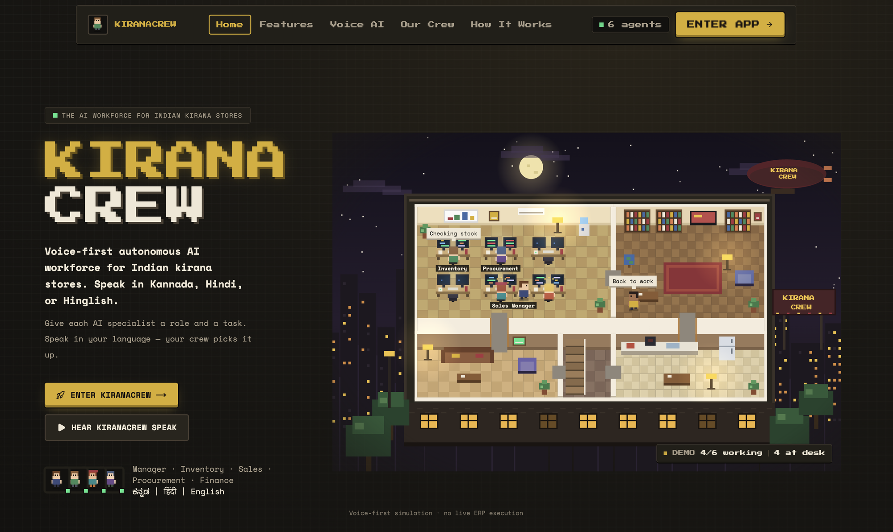
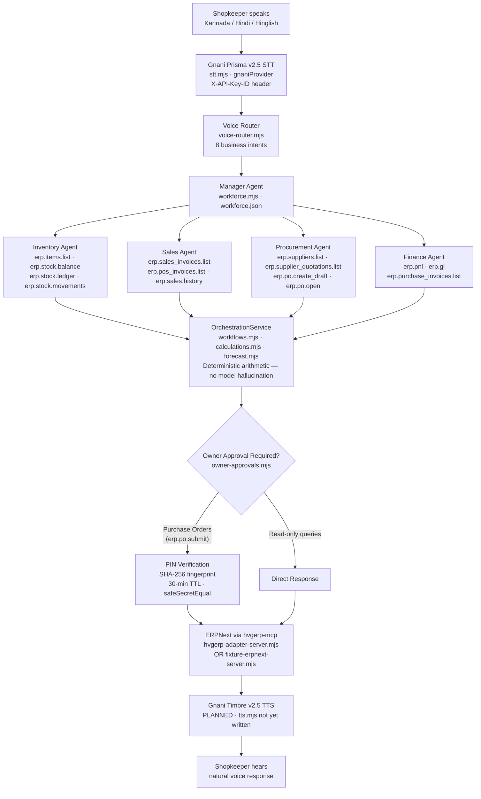

<div align="center">

# KIRANACREW

### Your Language. Your Store. Your Voice.

**Voice-first autonomous AI workforce for Indian kirana stores**

_Speak in Kannada, Hindi or Hinglish — your AI crew handles the rest_

---

[](https://nextjs.org)
[](https://www.typescriptlang.org)
[](https://gnani.ai)
[](LICENSE)
[](https://www.gnani.ai/internship)
[](lib/__tests__)
[](.node-version)

---

[The Problem](#the-problem) · [The Solution](#the-solution) · [Demo](#live-demo--screenshots) · [Five Agents](#the-five-agent-workforce) · [Gnani AI](#gnani-ai-integration) · [Architecture](#architecture) · [Quick Start](#getting-started) · [Testing](#testing)

---



_KiranaCrew — voice-first AI workforce for Indian kirana stores_

</div>

---

## The Problem

India has over **13 million kirana stores** — neighbourhood grocery shops that form the backbone of the country's retail economy. Together they move more than $800 billion in goods every year, yet almost all of them operate on paper ledgers and WhatsApp messages.

The barriers are steep and compounded:

- **Language barrier.** Most shopkeepers are fluent in Kannada, Hindi or their local dialect — not in the English that every existing inventory and accounting tool demands.
- **Software complexity.** ERP systems like ERPNext are powerful but assume a trained accounts staff that the typical kirana owner cannot hire or afford.
- **No data-driven decisions.** Without accessible analytics, restocking is guesswork. Orders are placed by memory. Suppliers are chosen by habit rather than current price and lead time.
- **Supplier negotiations are manual.** Each reorder involves phone calls to check who has stock, at what price, and when it will arrive — time the owner cannot spare while serving customers.
- **No financial visibility.** Profit is inferred from the cash drawer at the end of the day, not from a P&L statement tied to submitted invoices.

KiranaCrew was built to dissolve every one of these barriers at once, without requiring the shopkeeper to learn new software or change how they speak.

---

## The Solution

KiranaCrew gives every kirana store a **five-agent AI workforce** that operates entirely through voice. The shopkeeper speaks naturally, and the agents handle the rest:

1. **Shopkeeper speaks** in Kannada, Hindi or Hinglish.
2. **Gnani Prisma v2.5 STT** converts speech to text with Indian-language accuracy.
3. **Voice router** (`lib/server/nammaops/voice-router.mjs`) identifies one of eight supported business intents.
4. **Manager Agent** delegates to the right specialist.
5. **Specialist agents** — Inventory, Sales, Procurement, Finance — each read only the ERPNext data their role permits, through Phase C MCP governance.
6. **Deterministic calculations** in `calculations.mjs` and `forecast.mjs` produce numbers from real ERP data, not from a language model's inference.
7. **Gnani Timbre v2.5 TTS** [PLANNED] speaks the result back in the shopkeeper's language.

The critical difference from a chatbot: agents **take autonomous action**. The Procurement Agent reads real supplier quotations, picks the cheapest valid supplier, and creates a draft purchase order in ERPNext — no human typing required. The shopkeeper reviews the draft and approves it with a PIN.

---

## Live Demo / Screenshots

|                                                             |                                                           |
| :---------------------------------------------------------: | :-------------------------------------------------------: |
|      |  |
|              _Live Store — 3D store overview_               |        _Chat & Inbox — shared crew conversations_         |
|  |      |
|     _AI Workforce — agent status and ERP capabilities_      |         _Customers — sales and customer insights_         |

---

## The Five-Agent Workforce

Each agent is defined in `config/nammaops/workforce.json` and wired up through `lib/server/nammaops/workforce.mjs`. Every agent receives only the ERP capabilities its role requires — nothing more.

| Agent                                          | Role                                                                              | Key ERP Capabilities                                                                                                            | Status        |
| ---------------------------------------------- | --------------------------------------------------------------------------------- | ------------------------------------------------------------------------------------------------------------------------------- | ------------- |
| **Manager Agent** (`nammaops-manager`)         | Coordinates store operations; routes requests; consolidates results for the owner | No direct ERP access                                                                                                            | [IMPLEMENTED] |
| **Inventory Agent** (`nammaops-inventory`)     | Monitors stock levels; identifies low-stock products                              | `erp.items.list`, `erp.stock.balance`, `erp.warehouses.list`, `erp.stock.ledger`, `erp.stock.movements`                         | [IMPLEMENTED] |
| **Sales Agent** (`nammaops-sales`)             | Analyses sales performance; reads invoices and POS data                           | `erp.sales_invoices.list`, `erp.pos_invoices.list`, `erp.customers.list`, `erp.sales.history`                                   | [IMPLEMENTED] |
| **Procurement Agent** (`nammaops-procurement`) | Compares suppliers; calculates order quantities; creates draft POs                | `erp.suppliers.list`, `erp.supplier_quotations.list`, `erp.item_prices.get`, `erp.po.create_draft`, `erp.po.get`, `erp.po.open` | [IMPLEMENTED] |
| **Finance Agent** (`nammaops-finance`)         | Produces P&L summaries from posted accounting data                                | `erp.pnl`, `erp.gl`, `erp.purchase_invoices.list`, `erp.payments.summary`                                                       | [IMPLEMENTED] |

### Manager Agent [IMPLEMENTED]

The Manager Agent (`nammaops-manager`) has no direct ERP access by design. It parses the owner's natural-language command via `parseCommand()` in `workflows.mjs`, identifies one of five intents (`stock_check`, `prepare_reorder`, `daily_report`, `demand_forecast`, `supplier_comparison`), and delegates to the appropriate specialist agents. It then consolidates all results into a single owner-facing summary. When `NAMMAOPS_REASONING=manager` is set, it makes one optional OpenClaw reasoning turn over the verified facts — but only after the deterministic numbers are computed, and only if the model's figures match the ERP-sourced values exactly.

### Inventory Agent [IMPLEMENTED]

The Inventory Agent (`nammaops-inventory`) reads the full item catalogue and current stock balances from ERPNext. The `analyseStock()` function in `calculations.mjs` computes whether each item is at or below its reorder level, and calculates the recommended purchase quantity using the formula `max(reorder_qty, 2 × reorder_level − available)`. The agent is forbidden from changing stock quantities, submitting adjustments, or creating purchase orders.

### Sales Agent [IMPLEMENTED]

The Sales Agent (`nammaops-sales`) reads submitted sales invoices and POS invoices for a given date range. `aggregateSales()` in `calculations.mjs` computes total sales revenue, transaction count, and a top-five product ranking by sales amount. The agent cannot create or modify invoices or process payments.

### Procurement Agent [IMPLEMENTED]

The Procurement Agent (`nammaops-procurement`) is the most capable specialist. `rankSuppliers()` in `calculations.mjs` scores each supplier quotation by availability (can they supply the requested quantity?), validity (has the quotation expired?), then rate, lead time, and on-time delivery rate. The agent can create draft purchase orders in ERPNext via `erp.po.create_draft`, but cannot submit them — that requires explicit owner PIN approval through the `OwnerApprovals` class in `owner-approvals.mjs`.

### Finance Agent [IMPLEMENTED]

The Finance Agent (`nammaops-finance`) reads the posted Profit and Loss report from ERPNext for a given period. It explicitly refuses to estimate profit from sales invoices or purchase orders — it reports only what accounting has posted. When the P&L income differs from the invoice total by more than 1%, it raises a warning to the owner rather than silently reconciling the discrepancy.

---

## Gnani AI Integration

KiranaCrew was built specifically for the **Great Indian AI Internship Challenge 2026** by Gnani AI. Gnani's voice models solve a problem that no general-purpose speech platform does well: accurate, low-latency transcription for Indian languages in a noisy kirana store environment.

### A. Prisma v2.5 STT [IMPLEMENTED — API KEY CONFIGURATION REQUIRED]

Gnani Prisma v2.5 is the speech-to-text provider for all voice commands. The integration lives in `lib/server/stt.mjs`.

**Code path:**

```
Shopkeeper speaks → browser captures audio →
POST /api/tasks/voice (with audio blob) →
createSttProvider(process.env) → gnaniProvider({ apiKey }) →
POST https://api.vachana.ai/stt/v3 (X-API-Key-ID header) →
{ transcript, provider: "gnani-prisma", requestId }
```

**How to activate:**

```env
# In .env.local
AGENT_TOWN_STT_PROVIDER=gnani
GNANI_API_KEY=your_gnani_api_key
```

**Languages supported** (via `language_code` and `preferred_language` fields):

- `kn-IN` — Kannada
- `hi-IN` — Hindi
- `en-IN` — Indian English / Hinglish
- `indic-auto` — automatic Indic language detection

**Current status:** The `gnaniProvider()` function is fully implemented and tested. The `.env.example` file lists `GNANI_API_KEY` as commented out with the note "NOT WIRED YET" — meaning the code is complete but the API key environment variable is not read by default. Set `AGENT_TOWN_STT_PROVIDER=gnani` and `GNANI_API_KEY=your_key` to activate it. Without a key, the server falls back to `AGENT_TOWN_STT_PROVIDER=gemini` (Google Gemini STT) or `fixture` (deterministic test transcript).

**Example interaction:**

```
Shopkeeper says (Kannada): "Haalina stock check maadi."
Gnani Prisma transcribes: "Haalina stock check maadi."
Voice router maps intent: check_stock → products: ["haalu"] (milk)
Inventory Agent reads: erp.items.list + erp.stock.balance
Result: "Milk (MILK-500): 18 units in stock, reorder level 20 (low). Buy 22 units."
```

### B. Timbre v2.5 TTS [PLANNED]

Gnani Timbre v2.5 is the planned text-to-speech provider that would speak results back to the shopkeeper in their own language. **No `tts.mjs` file exists in the codebase.** The `.env.example` reserves `GNANI_TTS_URL` and `GNANI_TTS_VOICE` but explicitly marks the entire Gnani voice section as "NOT WIRED YET."

**What needs to be built:**

```javascript
// lib/server/tts.mjs (PLANNED)
export function timbreProvider({ apiKey, url, voice }) {
  return {
    name: "gnani-timbre",
    synthesize: async ({ text, language }) => {
      // POST to GNANI_TTS_URL with X-API-Key-ID header
      // return { audio: Buffer, mimeType: "audio/wav" }
    },
  };
}
```

The voice router contract in `voice-router.mjs` already structures results as `facts`, `recommendations`, and `limitations` arrays — these are designed to be spoken directly once Timbre TTS is wired.

### C. Evon v3.3 [PLANNED — SELF-HOSTED ONLY]

Gnani Evon v3.3 is a self-hosted speech foundation model requiring H100 or A100 GPU hardware. It is not integrated and is not referenced anywhere in the codebase. It would provide the highest-accuracy Indic language transcription for a production deployment with dedicated infrastructure.

**Why it is marked planned:** Evon is open-weights, not a hosted API. Integrating it would require a separate inference endpoint, GPU cluster provisioning, and a custom adapter in `stt.mjs`. The current architecture supports this — `createSttProvider()` dispatches on `AGENT_TOWN_STT_PROVIDER` and any new value can register a provider — but the adapter is not written.

---

## Architecture



**Three architectural rules that make KiranaCrew trustworthy:**

1. **Numbers come from ERP, not from a language model.** Every quantity, total, and recommendation is computed by deterministic functions in `calculations.mjs` and `forecast.mjs` over data returned by ERPNext tools. A model cannot hallucinate a stock balance.

2. **Each agent sees only what its role permits.** Phase C MCP governance (`mcp-governance.mjs`) enforces capability grants per agent identity. The Finance Agent cannot read supplier quotations. The Inventory Agent cannot submit purchase orders. These are hard server-side rules, not prompt instructions.

3. **Purchase orders require explicit owner approval.** No purchase is submitted to ERPNext without the owner's PIN, an unexpired approval request, and a SHA-256 fingerprint match confirming the draft has not changed since it was presented.

---

## End-to-End Workflow Example

**Command:** "Check the stock of milk, rice and cooking oil."

| Step                   | What happens                                                                                                                | File                                   | Status                             |
| ---------------------- | --------------------------------------------------------------------------------------------------------------------------- | -------------------------------------- | ---------------------------------- |
| 1. Voice capture       | Browser records audio, sends to `POST /api/tasks/voice`                                                                     | `lib/voice/audio.ts`                   | [IMPLEMENTED]                      |
| 2. STT transcription   | `gnaniProvider()` (or `geminiProvider()` / `fixtureProvider()`) returns transcript                                          | `lib/server/stt.mjs`                   | [IMPLEMENTED] (Gnani key required) |
| 3. Intent detection    | `parseCommand()` matches `/\bcheck\b.*\bstock\b/` pattern → `stock_check` intent, products: `["milk","rice","cooking oil"]` | `lib/server/nammaops/workflows.mjs`    | [IMPLEMENTED]                      |
| 4. Manager delegates   | `Workflows.stockCheck()` calls `readStock()` → Inventory Agent step                                                         | `lib/server/nammaops/workflows.mjs`    | [IMPLEMENTED]                      |
| 5. Inventory reads ERP | `erp.items.list` + `erp.stock.balance` called as governed MCP tools under `nammaops-inventory` identity                     | `lib/server/mcp-governance.mjs`        | [IMPLEMENTED]                      |
| 6. Stock analysis      | `analyseStock()` computes available vs. reorder level for each item                                                         | `lib/server/nammaops/calculations.mjs` | [IMPLEMENTED]                      |
| 7. Supplier ranking    | If items are low, `rankForLow()` calls Procurement Agent to read quotations and rank suppliers                              | `lib/server/nammaops/workflows.mjs`    | [IMPLEMENTED]                      |
| 8. Voice contract      | `VoiceRouter.result()` shapes facts into speakable arrays                                                                   | `lib/server/nammaops/voice-router.mjs` | [IMPLEMENTED]                      |
| 9. TTS response        | Gnani Timbre speaks the result                                                                                              | `lib/server/tts.mjs`                   | [PLANNED]                          |

The same stock check workflow powers the `check_stock` and `list_products` voice intents. The `prepare_reorder` workflow extends it by also creating draft purchase orders in ERPNext.

---

## Getting Started

### Prerequisites

- Node.js 22.19.0 or later
- pnpm 10.20.0
- An authenticated OpenClaw or Nightshift gateway installation

### Installation

```bash
git clone https://github.com/rajatnagda45/KiranaCrew.git kiranacrew
cd kiranacrew
pnpm install --frozen-lockfile
cp .env.example .env.local
# Edit .env.local — see Environment Variables below
pnpm dev
```

Open [http://localhost:3000](http://localhost:3000)

### KiranaCrew workforce (kirana store backend)

The KiranaCrew panel is the kirana-specific interface. Configure these variables in `.env.local`:

```env
# Required for owner purchase order approval
NAMMAOPS_OWNER_PIN=your_secure_pin

# The app reads live ERPNext only; there is no built-in data. Read-only, requires ERPNEXT_* below:
NAMMAOPS_BINDING=config/nammaops/binding.hvgerp.json
# (The synthetic test fixture is for automated tests; it is refused at startup unless
# NAMMAOPS_ALLOW_FIXTURE=1 is also set, for development only.)
ERPNEXT_URL=https://your-site.m.frappe.cloud
ERPNEXT_API_KEY=your_erpnext_api_key
ERPNEXT_API_SECRET=your_erpnext_api_secret

# Optional: Gnani Prisma STT
AGENT_TOWN_STT_PROVIDER=gnani
GNANI_API_KEY=your_gnani_api_key

# Optional: OpenClaw gateway for agent reasoning
AGENT_PROVIDER=openclaw
GATEWAY_URL=ws://127.0.0.1:18789/
```

Then set up the workforce via the KiranaCrew panel or:

```bash
node --import tsx scripts/nammaops-demo.mjs
```

---

## Environment Variables

All variables are safe placeholders. Never commit real credentials.

| Variable                         | Purpose                                                                 | Required                    |
| -------------------------------- | ----------------------------------------------------------------------- | --------------------------- |
| `AGENT_PROVIDER`                 | AI gateway provider (`openclaw`, `nightshift`, `auggie`)                | Required                    |
| `GATEWAY_URL`                    | OpenClaw gateway WebSocket URL                                          | Required for OpenClaw       |
| `GATEWAY_TOKEN`                  | OpenClaw gateway auth token                                             | Required for OpenClaw       |
| `GEMINI_API_KEY`                 | Google Gemini Live voice sessions and Gemini STT fallback               | Optional                    |
| `GNANI_API_KEY`                  | Gnani Prisma v2.5 STT — set `AGENT_TOWN_STT_PROVIDER=gnani` to activate | Optional                    |
| `GNANI_STT_URL`                  | Override Gnani STT endpoint (default: `https://api.vachana.ai/stt/v3`)  | Optional                    |
| `GNANI_TTS_URL`                  | Gnani Timbre TTS endpoint [PLANNED — not read yet]                      | Planned                     |
| `GNANI_TTS_VOICE`                | Gnani Timbre voice ID [PLANNED — not read yet]                          | Planned                     |
| `NAMMAOPS_OWNER_PIN`             | Store-owner PIN for approving purchase orders                           | Required for approvals      |
| `NAMMAOPS_BINDING`               | Binding file path (`binding.fixture.json` or `binding.hvgerp.json`)     | **Required** (live binding) |
| `NAMMAOPS_WORKFORCE`             | Workforce file path (default: `config/nammaops/workforce.json`)         | Optional                    |
| `NAMMAOPS_REASONING`             | `off` (deterministic) or `manager` (one OpenClaw turn per workflow)     | Optional                    |
| `ERPNEXT_URL`                    | ERPNext / Frappe Cloud base URL                                         | Required for live ERP       |
| `ERPNEXT_API_KEY`                | ERPNext API key (dedicated `nammaops.api` user)                         | Required for live ERP       |
| `ERPNEXT_API_SECRET`             | ERPNext API secret                                                      | Required for live ERP       |
| `AGENT_TOWN_STT_PROVIDER`        | STT provider: `gnani`, `gemini`, or `fixture`                           | Optional (unset = 503)      |
| `AGENT_TOWN_DB_PATH`             | SQLite database path (default: `data/agent-town.sqlite`)                | Optional                    |
| `NIGHTSHIFT_BASE_URL`            | Meterless Nightshift API base URL                                       | Required for Nightshift     |
| `NIGHTSHIFT_API_KEY`             | Nightshift API key                                                      | Required for Nightshift     |
| `NVIDIA_API_KEY`                 | NVIDIA hosted inference key                                             | Optional                    |
| `TAVILY_API_KEY`                 | Tavily web search key for evidence retrieval                            | Optional                    |
| `OPENCLAW_PROTOCOL_MODULE`       | Absolute path to OpenClaw protocol module                               | Optional (auto-discovery)   |
| `AGENT_TOWN_MCP_STDIO_ALLOWLIST` | JSON array of allowed MCP stdio server commands                         | Optional                    |
| `AGENT_TOWN_MCP_PROXY_SECRET`    | Shared secret for the governed MCP proxy                                | Optional                    |

---

## Testing

```bash
pnpm test
```

**Current test results: 1162 tests across 105 files, all passing.**

Key test files for KiranaCrew:

| File                                          | What it covers                                                                                                                             |
| --------------------------------------------- | ------------------------------------------------------------------------------------------------------------------------------------------ |
| `lib/__tests__/nammaops.test.ts`              | Full workforce setup, all five workflows, voice intents, owner approval, duplicate-prevention, audit trail — against the in-memory fixture |
| `lib/__tests__/nammaops-live-adapter.test.ts` | Live ERPNext adapter contract tests                                                                                                        |
| `lib/__tests__/nammaops-forecast.test.ts`     | Deterministic forecast engine: `forecastItem()`, `backtest()`, `stockoutDays()`, `dailyDemand()`, and all four forecast methods            |
| `lib/__tests__/mcp-governance.test.ts`        | Phase C governance: capability discovery, risk review, grant enforcement, per-agent identity, invocation audit                             |
| `lib/__tests__/voice-agent.test.ts`           | Voice agent tool execution and routing                                                                                                     |
| `lib/__tests__/voice-service.test.ts`         | STT provider selection and transcription pipeline                                                                                          |

---

## Hackathon Context

KiranaCrew was submitted to the **Great Indian AI Internship Challenge 2026** run by Gnani AI.

**Why this project is novel:**

- **Voice-first for Bharat.** No English required. The shopkeeper speaks in Kannada or Hindi and gets a reply in the same language.
- **Autonomous action, not chatbot answers.** The system reads live ERP data, computes results with deterministic arithmetic, and creates purchase order drafts — all without the shopkeeper touching a keyboard.
- **Governed multi-agent architecture.** Each agent has a role, a fixed set of ERP capabilities, and a hardware-enforced boundary. No agent can exceed its permissions.
- **Owner retains authority.** No purchase is submitted without the owner's explicit PIN approval and a fingerprint check that the draft has not changed.
- **Production-grade safety.** Prompt injection fencing (`fenceUntrusted`), EmergencyStop, read-only ERP access by default, and credential isolation.

**Real-world impact potential:** Giving India's 13 million kirana stores access to voice-driven stock management and procurement could reduce stockouts, lower procurement costs through supplier comparison, and provide the first accessible financial visibility for stores that have never run a P&L report.

---

## Security and Governance

| Control                      | Implementation                                                                                                                                                                                      | File                                      |
| ---------------------------- | --------------------------------------------------------------------------------------------------------------------------------------------------------------------------------------------------- | ----------------------------------------- |
| **MCP governance**           | Every ERP tool call goes through `CapabilityRegistry` + `Governance` + `ToolGateway`. Agents can only call tools they have been explicitly granted.                                                 | `lib/server/mcp-governance.mjs`           |
| **Owner PIN approval**       | Purchase order submission requires the owner's PIN, an unexpired request (30-min TTL), and a SHA-256 fingerprint match confirming the draft is unchanged.                                           | `lib/server/nammaops/owner-approvals.mjs` |
| **Read-only ERP by default** | All five agents have only READ-risk capabilities except the Procurement Agent's `erp.po.create_draft` (WRITE) and the dedicated `nammaops-po-submit` principal's `erp.po.submit` (EXTERNAL_ACTION). | `config/nammaops/binding.fixture.json`    |
| **Prompt injection fencing** | Content returned from ERP tools is treated as untrusted data. `fenceUntrusted()` prevents injected instructions from escalating.                                                                    | `lib/server/untrusted-content.mjs`        |
| **EmergencyStop**            | `estop.mjs` provides a file-based stop mechanism that pauses new work without killing in-flight tasks or corrupting their execution history.                                                        | `lib/server/estop.mjs`                    |
| **Credential isolation**     | `ERPNEXT_API_KEY`, `ERPNEXT_API_SECRET`, and `GNANI_API_KEY` are server-side only. They are never sent to the browser or the voice client.                                                          | `.env.example`                            |
| **Invocation audit**         | Every governed MCP tool call is recorded with agent identity, capability, arguments (redacted), and outcome.                                                                                        | `lib/server/mcp-governance.mjs`           |

---

## Roadmap

Based on what is in `.env.example` and the current implementation state:

| Feature                   | Status                       | What is needed                                                                                  |
| ------------------------- | ---------------------------- | ----------------------------------------------------------------------------------------------- |
| Gnani Prisma v2.5 STT     | [IMPLEMENTED — key required] | Set `AGENT_TOWN_STT_PROVIDER=gnani` and `GNANI_API_KEY`                                         |
| Gnani Timbre v2.5 TTS     | [PLANNED]                    | Write `lib/server/tts.mjs` with `timbreProvider()`, wire to `GNANI_TTS_URL` / `GNANI_TTS_VOICE` |
| Gnani Evon v3.3           | [PLANNED]                    | Self-hosted inference endpoint on H100/A100; write adapter in `stt.mjs`                         |
| Live ERPNext connection   | [IMPLEMENTED]                | Set `NAMMAOPS_BINDING=binding.hvgerp.json` with `ERPNEXT_*` credentials                         |
| Manager reasoning mode    | [IMPLEMENTED]                | Set `NAMMAOPS_REASONING=manager`                                                                |
| Kannada / Hindi UI labels | [PLANNED]                    | i18n layer over the KiranaCrew panel components                                                 |
| Mobile PWA                | [PLANNED]                    | Progressive Web App shell for shopkeeper's phone                                                |
| Multi-store support       | [PLANNED]                    | Tenant isolation layer over the current single-workspace architecture                           |

---

## Built With

| Technology                       | Role                                           |
| -------------------------------- | ---------------------------------------------- |
| **Gnani AI Prisma v2.5**         | Indian-language speech-to-text                 |
| **Gnani AI Timbre v2.5**         | Indian-language text-to-speech [PLANNED]       |
| **ERPNext / Frappe Cloud**       | Kirana store ERP backend                       |
| **hvgerp-mcp v3.7.0**            | Read-only MCP adapter for ERPNext              |
| **Next.js 16**                   | Application framework                          |
| **React 19**                     | UI components                                  |
| **TypeScript 5**                 | Type safety across the full stack              |
| **Node.js SQLite**               | Durable workflow state and audit trail         |
| **Model Context Protocol (MCP)** | Governed tool interface between agents and ERP |
| **Vitest**                       | Test runner (1162 tests, 105 files)            |
| **Phaser 3**                     | 2D office scene                                |
| **Three.js**                     | 3D office scene                                |

## Credits

Built for the **Great Indian AI Internship Challenge 2026** by [Gnani AI](https://gnani.ai).

Voice models: Gnani Prisma v2.5 STT / Gnani Timbre v2.5 TTS (planned) / Gnani Evon v3.3 (planned).

---

<div align="center">

### Speak to your store. Your AI crew handles the rest.

_KiranaCrew — voice-first AI workforce for Indian kirana stores_

</div>
