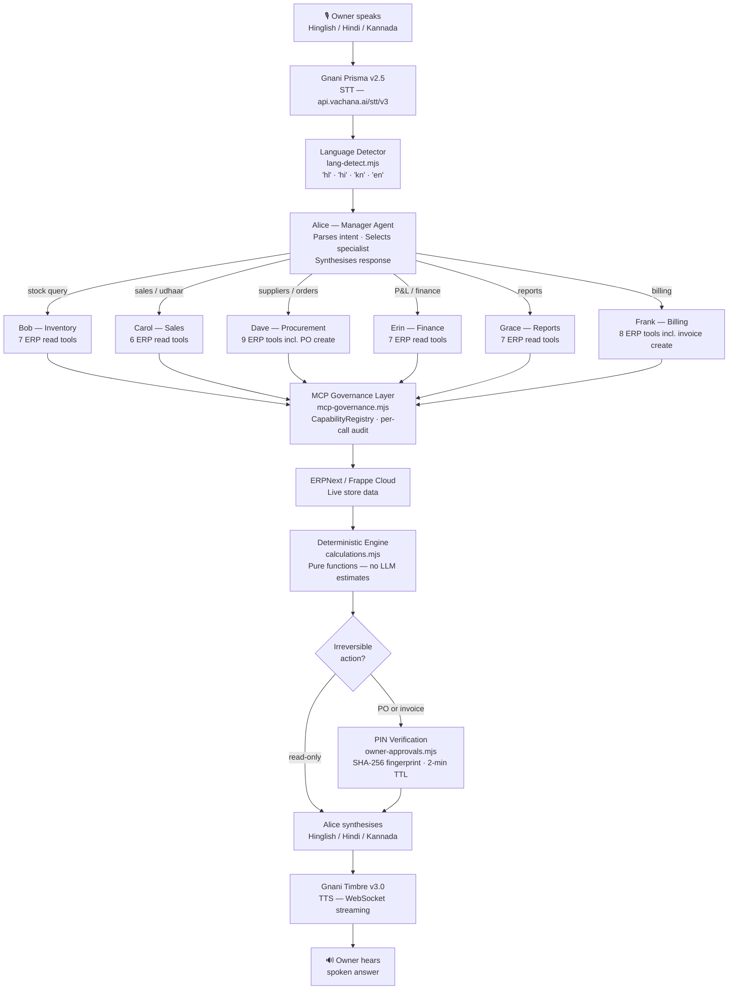

<div align="center">

# KiranaCrew

### "Dukaan ka kaam, ab aawaz se!"

**Voice-first, manager-led multi-agent AI workforce for Indian kirana stores**

Speak in Hinglish, Hindi or Kannada. Alice (manager) coordinates six specialist agents that plan, call real ERP tools, and handle the work — no typing, no ERP login required.

---

[](https://hack4hack.com/hackathons/agentx-hackathon-2026-hooc)
[](#the-seven-agent-workforce)
[](lib/__tests__)
[](https://nextjs.org)
[](LICENSE)

---

[Why an Agent](#why-an-agent-not-a-chatbot) · [Problem](#the-problem) · [Architecture](#manager-led-architecture) · [Agents](#the-seven-agent-workforce) · [Workflows](#real-execution-workflows) · [Security](#human-in-the-loop--security) · [Voice Pipeline](#end-to-end-voice-pipeline) · [Demo](#demo--screenshots) · [Setup](#setup) · [Tests](#tests)

---

🎬 **[Demo Video (YouTube)](https://www.youtube.com/watch?v=ID-dp83yWhI)**
&nbsp;&nbsp;|&nbsp;&nbsp;
📊 **[Pitch Deck (Google Slides)](https://docs.google.com/presentation/d/17I9xhbS3eBN0Ou_cVkNZqyfdQvEr_ORG/edit?usp=sharing)**

[](https://www.youtube.com/watch?v=ID-dp83yWhI)

</div>

---

## Why an Agent, Not a Chatbot

> PS-07 requires: _the agent plans its own steps, takes real actions through at least two tools or APIs, and asks for human confirmation before anything irreversible._

|                      | Chatbot              | KiranaCrew                                  |
| -------------------- | -------------------- | ------------------------------------------- |
| **Input**            | Text/voice question  | Voice command in Hinglish / Hindi / Kannada |
| **Understanding**    | Answers the question | Parses intent, identifies business domain   |
| **Planning**         | None                 | Alice selects the right specialist agent    |
| **Action**           | Gives recommendation | Specialist calls real ERPNext MCP tools     |
| **Calculation**      | LLM estimates        | Deterministic arithmetic on live ERP data   |
| **Write operations** | None                 | Creates draft PO or invoice in ERPNext      |
| **Human gate**       | None                 | Owner PIN required before submission        |
| **Response**         | Text answer          | Spoken result in the owner's language       |

**One example, one voice command:**

> _"Milk ka stock check karo aur best supplier batao."_

1. Alice identifies: inventory query + procurement query
2. Bob calls `erp.items.list` + `erp.stock.balance` → stock levels checked
3. Dave calls `erp.suppliers.list` + `erp.supplier_quotations.list` + `erp.item_prices.get` → suppliers ranked
4. Dave calls `erp.po.create_draft` → draft purchase order created in ERPNext
5. Alice speaks the recommendation; owner enters PIN; PO is submitted

That is **5 real ERPNext tool calls, deterministic ranking, 1 human confirmation** — from a single Hinglish voice command.

---

## The Problem

India's kirana stores — small neighbourhood grocery retailers — are the backbone of local commerce. The owners are fluent in Hindi, Kannada, or Hinglish, not in ERP systems designed for English-speaking accountants.

| Operational challenge    | Current reality                                      |
| ------------------------ | ---------------------------------------------------- |
| Stock visibility         | Manual counting per item, error-prone                |
| Supplier selection       | Phone calls, personal habit, no data comparison      |
| Purchase order creation  | Manual ERP entry — most owners skip it entirely      |
| Financial reporting      | No structured P&L — profit equals cash in hand       |
| Credit tracking (udhaar) | Paper slips, often disputed                          |
| Language                 | ERPNext requires English; most owners are not fluent |

KiranaCrew gives every kirana owner a voice-operated crew that handles all of this in their own language, using real ERP data — not estimates or chatbot responses.

> **Demo mode:** This hackathon submission uses a synthetic fixture dataset (`config/nammaops/binding.fixture.json`). No real customer data, inventory, or financial records are used. See [Setup](#setup) for how to connect a real ERPNext instance.

---

## Manager-led Architecture

Alice is the **only agent the owner interacts with**. She receives every request, determines which specialist to involve, delegates once (1:1, never broadcast), waits for the result, and delivers a single spoken answer. Alice has no ERP tool access — her role is exclusively orchestration.



**Key architectural properties:**

- **1:1 delegation.** Alice delegates to exactly one specialist per domain. Cross-domain requests are split into sequential delegations. No broadcast messaging.
- **Session isolation.** Each specialist operates in its own conversation session (`agent:<backend>:<specialist>`). Specialists never share context.
- **Governance-first.** Every ERP tool call passes through `CapabilityRegistry` → policy `decide()` → invocation → audit record. The policy runs immediately before each call, not at session start.
- **Numbers from ERP only.** `calculations.mjs` contains ten pure functions. No LLM call is ever made inside the calculation layer. Every rupee, unit count, and ranking is deterministic arithmetic.

---

## The Seven-Agent Workforce

### Alice — Manager Agent

Alice routes every request. She reads no ERP data directly. Source: `lib/server/nammaops/workforce.mjs`, `config/nammaops/workforce.json`.

### Capability Matrix

| Agent       | Name      | Responsibility                                                   | Permitted ERP Tools                                                                                                                                                                                             | Write access       |
| ----------- | --------- | ---------------------------------------------------------------- | --------------------------------------------------------------------------------------------------------------------------------------------------------------------------------------------------------------- | ------------------ |
| Manager     | **Alice** | Orchestration, delegation, synthesis                             | None                                                                                                                                                                                                            | No                 |
| Inventory   | **Bob**   | Stock levels, reorder analysis, demand forecasting, batch/expiry | `erp.items.list` · `erp.stock.balance` · `erp.warehouses.list` · `erp.stock.ledger` · `erp.stock.movements` · `erp.items.valuation` · `erp.batches.list`                                                        | No                 |
| Sales       | **Carol** | Sales performance, top products, udhaar, customer insights       | `erp.sales_invoices.list` · `erp.pos_invoices.list` · `erp.customers.list` · `erp.items.list` · `erp.sales.history` · `erp.receivables.aging`                                                                   | No                 |
| Procurement | **Dave**  | Supplier comparison, purchase order drafting                     | `erp.suppliers.list` · `erp.supplier_quotations.list` · `erp.item_prices.get` · `erp.po.create_draft` · `erp.po.get` · `erp.po.open` · `erp.payables.aging` · `erp.purchase_invoices.list` · `erp.items.list`   | Draft PO only      |
| Finance     | **Erin**  | P&L, general ledger, GST, receivables, payables                  | `erp.pnl` · `erp.gl` · `erp.purchase_invoices.list` · `erp.payments.summary` · `erp.receivables.aging` · `erp.payables.aging` · `erp.gst.summary`                                                               | No                 |
| Reports     | **Grace** | Weekly/monthly business summaries across all domains             | `erp.sales_invoices.list` · `erp.pos_invoices.list` · `erp.items.list` · `erp.stock.balance` · `erp.pnl` · `erp.receivables.aging` · `erp.payables.aging`                                                       | No                 |
| Billing     | **Frank** | Customer bills, counter totals, invoice drafting                 | `erp.sales_invoices.list` · `erp.pos_invoices.list` · `erp.customers.list` · `erp.items.list` · `erp.receivables.aging` · `erp.sales_invoice.create_draft` · `erp.sales_invoice.get` · `erp.selling_prices.get` | Draft invoice only |

**Enforcement mechanism:** Capability grants are defined in `config/nammaops/workforce.json` and enforced at runtime in `lib/server/mcp-governance.mjs`. An agent that calls a tool outside its grant receives `DENY` with the reason logged in the audit trail. This is server-side enforcement — not prompt instructions.

---

## Real Execution Workflows

All workflows below use **sample data from the fixture dataset**. Actual numbers will differ in a live ERPNext deployment.

### Workflow 1 — Stock Intelligence (Alice → Bob)

```
Owner: "Kitna stock bacha hai?"

Alice → Bob: { action: "stock_check" }

Bob's execution:
  Step 1a: erp.items.list {}           → product catalogue (e.g. 212 items)   ┐
  Step 1b: erp.stock.balance {}        → bin quantities per warehouse          ┘ parallel (Promise.all)

  Step 2:  analyseStock(items, bins)   → compares qty_in_stock vs reorder_level
  Step 3:  rankForLow(items, bins)     → sorts by days-of-stock remaining

Bob → Alice: {
  low: [
    { item: "Milk 500ml", qty: 18, reorder_level: 20, days_left: 1.8 },
    { item: "Refined Oil 1L", qty: 4, reorder_level: 10, days_left: 0.6 },
    ...
  ]
}

Alice speaks: "52 products check kiye; 5 items low hain.
              Milk 500ml — 18 unit bache, 2 din ka stock.
              Refined Oil 1L — sirf 4 unit, aaj hi order karo."
```

`erp.items.list` and `erp.stock.balance` run in parallel (`Promise.all`) in `readStock()` — source: `lib/server/nammaops/workflows.mjs`.

---

### Workflow 2 — Procurement (Alice → Dave)

```
Owner: "Milk ka best supplier kaun hai, aur order karo."

Alice → Dave: { action: "supplier_comparison", products: ["milk"] }

Dave's execution:
  Step 1a: erp.suppliers.list {}                     ┐
  Step 1b: erp.supplier_quotations.list {}            ┤ parallel (Promise.all)
  Step 1c: erp.item_prices.get {}                    ┘

  Step 2:  rankSuppliers(itemCode, qty, quotations, suppliers, today)
           → scores each supplier: rate × lead_time × on_time_rate
  Step 3:  groupOrders(rankings) → group into one draft PO per supplier
  Step 4:  erp.po.create_draft { supplier, items, quantities }
           → draft PO created in ERPNext (status: "pending approval")

Dave → Alice: {
  supplier: "Amul Dairy",
  rate: "₹22/unit",
  delivery: "2 days",
  po_draft_id: "PUR-DRAFT-2026-00007"
}

Alice: "Amul Dairy best rate hai — ₹22/unit, 2 din delivery.
       Draft PO ready hai. Approve karne ke liye PIN enter karein."

Owner enters PIN → PO submitted to ERPNext (docstatus: 1 verified)
```

All three ERP reads in `supplierComparison()` are parallelised via `Promise.all` — source: `lib/server/nammaops/workflows.mjs`.

---

### Workflow 3 — Daily Report (Alice → Grace)

```
Owner: "Aaj ki report do."

Alice → Grace: { action: "daily_report", date: "2026-11-12" }

Grace's execution:
  Step 1a: erp.sales_invoices.list { date }   ┐
  Step 1b: erp.pos_invoices.list { date }     ┤ parallel (Promise.all)
  Step 1c: erp.pnl { date }                  ┘

  Step 2: aggregateSales(invoices, pos) → totals, transaction count, top products
  Step 3: perDay(invoices, from, to)    → day-by-day breakdown

Grace → Alice: {
  total: "₹24,800",
  transactions: 47,
  top_products: ["Milk 500ml", "Refined Oil 1L"],
  net_profit: "₹3,100"
}

Alice speaks: "Aaj ₹24,800 ki bikri hui — 47 transactions.
              Top product Milk 500ml. Net profit ₹3,100."
```

For multi-day reports, `readSlices()` reads date ranges in parallel batches (`SLICE_CONCURRENCY = 3`) to avoid ERP response-size limits.

---

### Workflow 4 — Finance & Udhaar (Alice → Erin)

```
Owner: "Ramesh ka udhaar kitna hai?"

Alice → Erin: { action: "receivables_report", focus: "due_soon" }

Erin's execution:
  Step 1a: erp.gl { customer: "Ramesh" }          ┐ parallel
  Step 1b: erp.payments.summary { customer }       ┘

  Step 2: aggregateReceivables(gl, payments) → outstanding + overdue days

Erin → Alice: {
  customer: "Ramesh",
  outstanding: "₹1,450",
  overdue_days: 12
}

Alice speaks: "Ramesh ka ₹1,450 udhaar bacha hai — 12 din se overdue."
```

---

### Workflow 5 — Billing (Alice → Frank)

```
Owner: "Rohan ke liye bill banao — 2 kg aata aur 1 litre oil."

Alice → Frank: { action: "prepare_bill", customer: "Rohan",
                 lines: [{product:"aata",qty:2},{product:"oil",qty:1}] }

Frank's execution:
  Step 1: resolveProducts(["aata","oil"], items)
          → fuzzy-matches spoken names to ERP item codes (Devanagari-aware)
  Step 2: erp.selling_prices.get { items }  → current prices
  Step 3: erp.sales_invoice.create_draft { customer, items, totals }

Frank → Alice: {
  invoice: "SINV-2026-00512",
  total: "₹245",
  status: "pending_approval"
}

Alice: "Rohan ke liye ₹245 ka bill ready hai — approve karne ke liye PIN enter karein."
```

---

## Human-in-the-Loop & Security

This section documents every mechanism that prevents autonomous action without owner consent. Source: `lib/server/nammaops/owner-approvals.mjs`, `lib/server/mcp-governance.mjs`.

### Operations requiring owner PIN

| Operation                         | Trigger                     | Mechanism                       |
| --------------------------------- | --------------------------- | ------------------------------- |
| Submit purchase order to supplier | Dave creates draft PO       | PIN challenge issued, 2-min TTL |
| Approve sales invoice             | Frank creates draft invoice | PIN challenge issued, 2-min TTL |
| Reject purchase order             | Owner decides to reject     | PIN required (same flow)        |

All other operations (stock checks, reports, supplier comparisons, finance queries) are **read-only** and require no approval.

### PIN verification flow (`owner-approvals.mjs`)

1. Draft document is created in ERPNext (`erp.po.create_draft` or `erp.sales_invoice.create_draft`)
2. `invoiceSnapshot()` / `orderSnapshot()` computes a SHA-256 fingerprint of the exact draft
3. PIN challenge issued — owner speaks or types PIN (4–8 digits; Devanagari numerals and word forms accepted)
4. `extractSpokenPin(text)` parses spoken digits; `redactSpokenDigits(text)` removes PIN from logs
5. PIN verified with persistent lockout rules
6. Approval stored (session-bound, 2-minute TTL)
7. Before submission: document is re-fetched and fingerprint re-verified — changed draft invalidates approval
8. Submission happens via a dedicated principal (`nammaops-po-submit` / `nammaops-bill-submit`) with `erp.po.submit` / `erp.sales_invoice.submit`
9. `docstatus: 1` confirmed from ERPNext response before reporting success

### MCP governance (`mcp-governance.mjs`)

| Control                     | Implementation                                                                                                                |
| --------------------------- | ----------------------------------------------------------------------------------------------------------------------------- |
| Capability grants           | Per-agent tool allowlist in `config/nammaops/workforce.json`; enforced by `CapabilityRegistry`                                |
| Policy decisions            | `decide()` runs immediately before each tool call: `ALLOW` / `DENY` / `REQUIRES_APPROVAL` / `UNAVAILABLE`                     |
| Audit log                   | Every invocation recorded: agent identity, tool, arguments (redacted), decision, outcome, timing                              |
| Prompt injection protection | ERP tool output is wrapped in `fenceUntrusted()` before any agent sees it                                                     |
| Emergency stop              | File-based `ESTOP` mechanism pauses all new work without corrupting in-flight tasks                                           |
| Credential isolation        | `GNANI_API_KEY`, `ERPNEXT_API_KEY`, `ERPNEXT_API_SECRET` are server-side environment variables — never exposed to the browser |

---

## End-to-End Voice Pipeline

```
Shopkeeper speaks
  → Gnani Prisma v2.5 STT   (api.vachana.ai/stt/v3, header: X-API-Key-ID)
  → Language detection        (hl / hi / kn / en — deterministic regex, no LLM)
  → Alice (manager)           (intent parsing, specialist selection)
  → Specialist agent          (Bob / Carol / Dave / Erin / Grace / Frank)
  → MCP governance            (capability check, audit)
  → ERPNext / Frappe Cloud    (live or fixture ERP data)
  → calculations.mjs          (pure deterministic functions)
  → Alice synthesises         (combines specialist output)
  → Gnani Timbre v3.0 TTS    (wss://api.vachana.ai/api/v1/tts, WebSocket streaming)
  → Shopkeeper hears result
```

| Step                | File                                      | Detail                                                       |
| ------------------- | ----------------------------------------- | ------------------------------------------------------------ |
| Audio capture       | `lib/voice/audio.ts`                      | Browser MediaRecorder (WAV / WebM / OGG)                     |
| Speech-to-text      | `lib/server/stt.mjs`                      | Gnani Prisma v2.5; fallback to Gemini on 5xx/timeout only    |
| Language detection  | `lib/server/nammaops/lang-detect.mjs`     | Devanagari → Kannada → Hinglish keywords → English           |
| Intent parsing      | `lib/server/nammaops/workflows.mjs`       | 15+ supported intents via `parseV2()` and `parseDays()`      |
| Specialist dispatch | `lib/server/nammaops/workforce.mjs`       | 1:1 delegation, isolated session per specialist              |
| ERP tool calls      | `lib/server/mcp-governance.mjs`           | Governed, audited, per-agent capability grants               |
| Calculations        | `lib/server/nammaops/calculations.mjs`    | 10 pure functions — no LLM inside                            |
| PIN approval        | `lib/server/nammaops/owner-approvals.mjs` | SHA-256 fingerprint, 2-min TTL, spoken PIN parsing           |
| Text-to-speech      | `lib/server/tts.mjs`                      | Gnani Timbre v3.0; WebSocket (default), SSE, REST transports |

**Supported languages:** `hl` Roman-script Hinglish · `hi` Devanagari Hindi · `kn` Kannada · `en` Indian English

**TTS voices (Timbre v3.0):** Avinash · Shivani · Lakshmi · Kalpana · Shubham · Prakash · Devansh · Yashraj · Chetana · Vasudha · Harshad · Riyaa · Tarika

---

## Demo & Screenshots

|                                                             |                                                           |
| :---------------------------------------------------------: | :-------------------------------------------------------: |
|      |  |
|         _3D store — agents visible at their desks_          |         _Alice coordinates the crew in real time_         |
|  |      |
|       _Seven agents with their ERP capability grants_       |          _Udhaar tracking and customer insights_          |

**Recommended demo journey:**

1. Open the store → speak a Hinglish stock query
2. Watch Alice delegate to Bob in the agent panel
3. See Bob's ERP tool calls appear in the activity timeline
4. Trigger a supplier query → Dave creates a draft PO
5. Approve with PIN → see PO submission confirmed
6. Ask for today's report → Grace aggregates across ERPNext in one spoken answer

---

## Setup

### Prerequisites

- Node.js ≥ 22.19.0
- pnpm 10.20.0
- Gnani API key (for Prisma STT + Timbre TTS)
- ERPNext / Frappe Cloud instance **or** use the built-in fixture (no ERP needed)

### Clone and install

```bash
git clone https://github.com/rajatnagda45/Kirana-Crew.git
cd Kirana-Crew
pnpm install --frozen-lockfile
cp .env.example .env.local
```

### Fixture mode (no ERPNext required — works immediately)

Add to `.env.local`:

```env
NAMMAOPS_BINDING=config/nammaops/binding.fixture.json
NAMMAOPS_ALLOW_FIXTURE=1
AGENT_TOWN_STT_PROVIDER=gnani
AGENT_TOWN_TTS_PROVIDER=gnani
GNANI_API_KEY=your_gnani_api_key
AGENT_PROVIDER=openclaw
GATEWAY_URL=ws://127.0.0.1:18789/
```

### Live ERPNext mode

```env
NAMMAOPS_BINDING=config/nammaops/binding.hvgerp.json
ERPNEXT_URL=https://your-site.m.frappe.cloud
ERPNEXT_API_KEY=your_key
ERPNEXT_API_SECRET=your_secret
NAMMAOPS_OWNER_PIN=your_secure_pin
AGENT_TOWN_STT_PROVIDER=gnani
AGENT_TOWN_TTS_PROVIDER=gnani
GNANI_API_KEY=your_gnani_api_key
GNANI_TTS_MODEL=timbre-v3.0
GNANI_TTS_VOICE=Avinash
GNANI_TTS_TRANSPORT=ws
GNANI_LANGUAGE=en-IN
AGENT_PROVIDER=openclaw
GATEWAY_URL=ws://127.0.0.1:18789/
```

> `GNANI_API_KEY`, `ERPNEXT_API_KEY`, and `ERPNEXT_API_SECRET` are server-side only. They are never sent to the browser.

### Start the server

```bash
pnpm dev
# Opens at http://localhost:3000
```

`pnpm dev` starts the Express backend (which also launches Next.js) in a single process.

---

## Tests

```bash
pnpm test
```

**Verified result: 1,907 tests · 138 files · all passing** (run locally on this submission; CI uses the same command).

| Test file                        | What it covers                                            |
| -------------------------------- | --------------------------------------------------------- |
| `alice-coordination.test.ts`     | 1:1 delegation logic, intent routing, synthesis           |
| `seven-agent-governance.test.ts` | Per-agent capability grants, cross-agent denial           |
| `nammaops.test.ts`               | Full workflows: stock, reorder, report, forecast, billing |
| `dm-delegation.test.ts`          | Direct-message delegation from Alice to each specialist   |
| `procurement-working.test.ts`    | Dave's supplier ranking and PO draft creation             |
| `follow-up.test.ts`              | Multi-turn conversation memory across sessions            |
| `draft-procurement-rest.test.ts` | Full REST flow: draft PO → owner approval → submission    |
| `bill-approval-prompt.test.tsx`  | PIN approval UI for invoices and purchase orders          |
| `mcp-governance.test.ts`         | Capability registry, audit trail, decision logging        |
| `nammaops-forecast.test.ts`      | Demand forecast: 4 methods, backtesting, stockout days    |
| `lang-detect.test.mjs`           | Hinglish/Hindi/Kannada/English discrimination             |
| `voice-service.test.ts`          | Gnani Prisma provider, Gemini fallback, fixture mode      |
| `alice-identity.test.ts`         | Alice persona consistency across all interaction types    |
| `stock-routing.test.ts`          | Bob's intent routing, reorder-level detection             |
| `dave-routing.test.ts`           | Dave's procurement routing, supplier query handling       |

---

## Technology Stack

| Technology                       | Role in KiranaCrew                                                               |
| -------------------------------- | -------------------------------------------------------------------------------- |
| **Gnani Prisma v2.5**            | Indic STT — transcribes Hinglish, Hindi, Kannada from noisy store audio          |
| **Gnani Timbre v3.0**            | Indic TTS — speaks results in natural Indian English/Hindi prosody via WebSocket |
| **ERPNext / Frappe Cloud**       | Store ERP backend — inventory, orders, invoices, finance                         |
| **Model Context Protocol (MCP)** | Governed tool interface — per-agent capability enforcement with audit            |
| **OpenClaw gateway**             | AI agent reasoning runtime — hosts all seven agents                              |
| **Next.js 16 + React 19**        | Full-stack app framework                                                         |
| **TypeScript 5**                 | End-to-end type safety                                                           |
| **Node.js SQLite**               | Workflow state, audit trail, message history                                     |
| **Phaser 3 + Three.js**          | 2D/3D store office scene with agent avatars                                      |
| **Vitest**                       | 1,907 tests across 138 files                                                     |

---

## Impact and Future Scope

### What is implemented and working

- Voice command → Alice → specialist agent → ERPNext tool call → deterministic calculation → spoken answer
- Six specialist agents with enforced per-agent capability grants
- Supplier comparison with deterministic ranking across rate, lead time, and reliability
- Draft purchase order creation + PIN-verified submission to ERPNext
- Draft sales invoice creation + PIN-verified submission
- Hinglish / Hindi / Kannada / English detection and response
- Multi-day report slicing to avoid ERP payload limits
- Demand forecast using four methods (exponential smoothing, moving average, seasonal, trend)
- 1,907 passing automated tests

### Expected impact (projection, not measured production data)

For a kirana store with 200+ products:

| Task                        | Manual effort                       | With KiranaCrew                                  |
| --------------------------- | ----------------------------------- | ------------------------------------------------ |
| Check stock of all products | 20–30 min per session (estimate)    | One voice query                                  |
| Identify reorder candidates | Relies on owner memory              | Automatic — below reorder level + days remaining |
| Compare supplier quotes     | Phone calls, 15–30 min (estimate)   | Deterministic ranking from live ERPNext quotes   |
| Create purchase order       | Manual ERP entry — skipped by most  | Voice-initiated, PIN-confirmed                   |
| Monthly P&L                 | Requires accountant or ERP training | On demand voice query                            |

These are qualitative estimates based on the store workflow. Measured production results are not yet available.

### Future roadmap

- Regional language expansion: Tamil, Telugu, Marathi
- WhatsApp Business API integration for voice/text without the web app
- Supplier communication agent (automated RFQ emails)
- Multi-store aggregation for chain operators
- GST filing workflow (currently Erin reports GST summary; filing not automated)

---

## Team — Agent Hunters

|                   |                                                                   |
| ----------------- | ----------------------------------------------------------------- |
| **Rajat Nagda**   | Backend, agent architecture, MCP governance, ERPNext integration  |
| **Ashwini Kumar** | Workflow engine, agent coordination, delegation logic, test suite |

**Submission:** [AgentX Hackathon 2026 — PS-07 Open Track](https://hack4hack.com/hackathons/agentx-hackathon-2026-hooc)

---

<div align="center">

_One voice command. Alice coordinates. Six agents act. The store runs itself._

</div>
