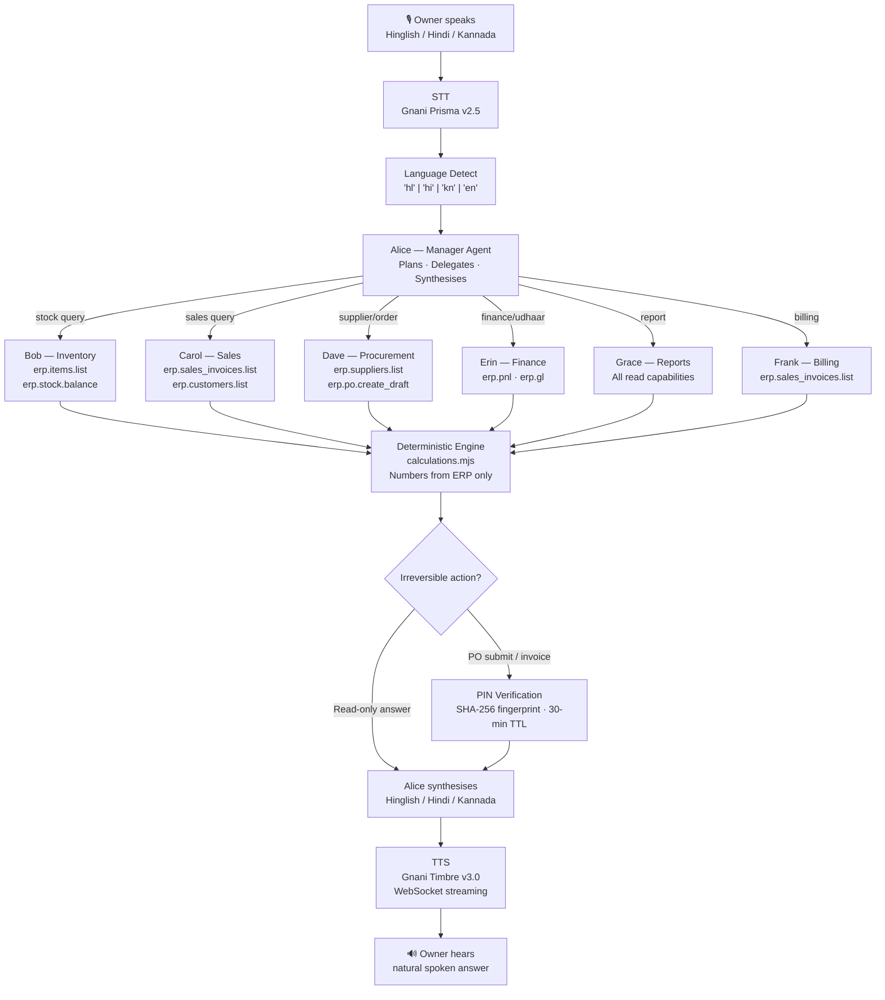
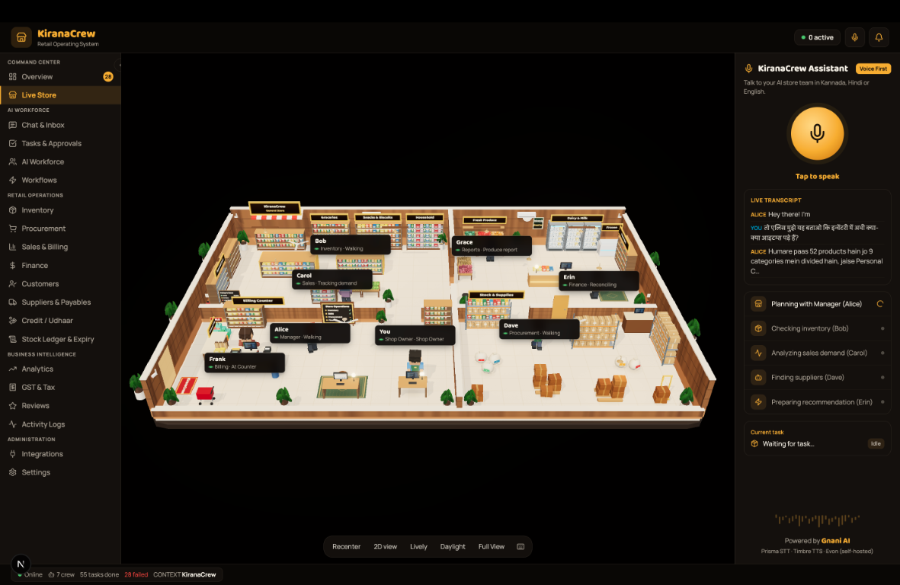
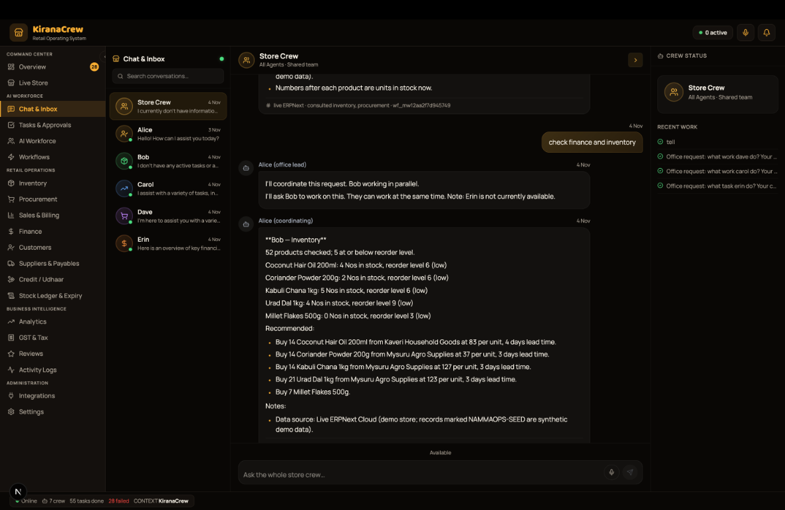
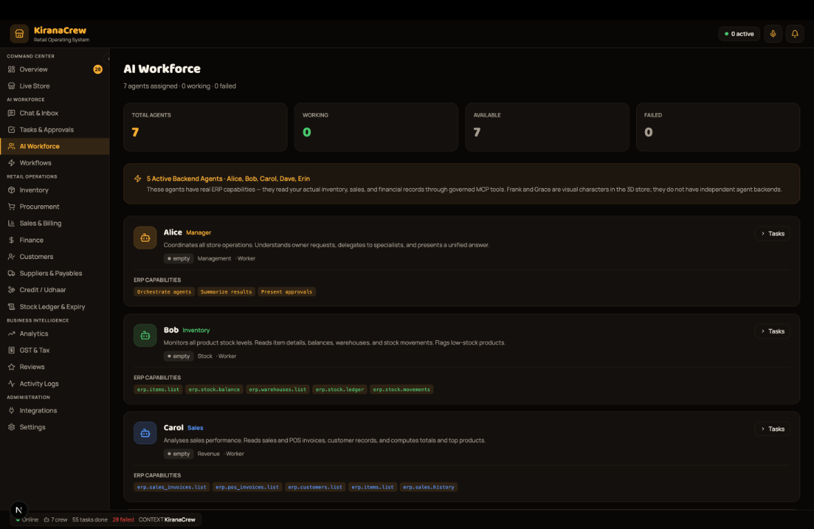
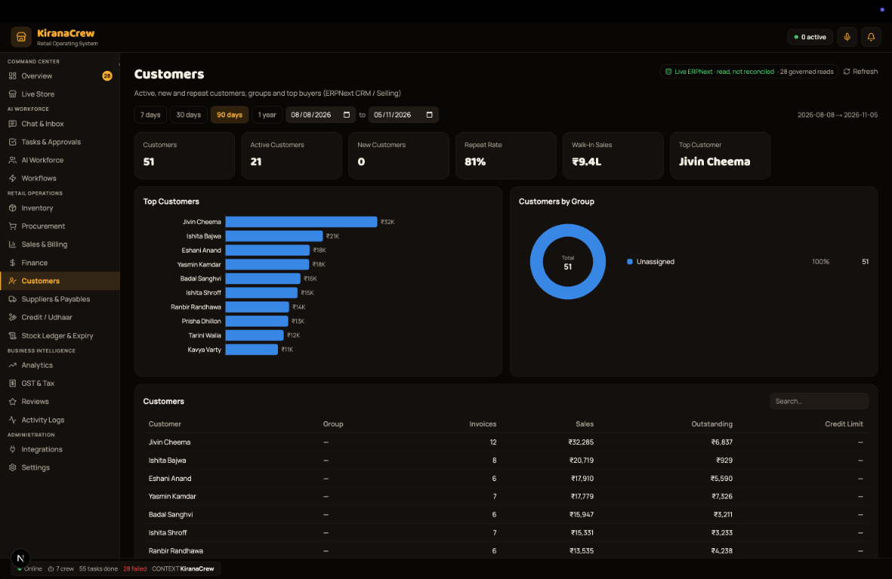

<div align="center">

# KiranaCrew

### "Dukaan ka kaam, ab aawaz se!"

**Voice-first multi-agent AI workforce for Indian kirana stores**

Speak in Hinglish, Hindi or Kannada — Alice coordinates seven specialist agents that plan, call real tools, and get the work done.

---

[](https://hack4hack.com/hackathons/agentx-hackathon-2026-hooc)
[](#the-seven-agent-workforce)
[](lib/__tests__)
[](https://nextjs.org)
[](LICENSE)

---

[Why an Agent](#why-an-agent-not-a-chatbot) · [The Problem](#the-problem) · [Manager Workflow](#alice-the-manager-agent) · [Seven Agents](#the-seven-agent-workforce) · [Agent Workflows](#agent-task-workflows) · [Architecture](#architecture) · [Demo](#demo) · [Quick Start](#quick-start)

---

🎬 **[Watch the Demo (YouTube)](https://www.youtube.com/watch?v=ID-dp83yWhI)**  
📊 **[Pitch Deck (Google Slides)](https://docs.google.com/presentation/d/17I9xhbS3eBN0Ou_cVkNZqyfdQvEr_ORG/edit?usp=sharing)**

[](https://www.youtube.com/watch?v=ID-dp83yWhI)

</div>

---

## Why an Agent, Not a Chatbot

A chatbot tells the owner "you have low stock."

**KiranaCrew's agent does this — from a single voice command:**

1. Alice (manager) receives the request and identifies which specialists are needed
2. Bob (inventory) calls `erp.items.list` + `erp.stock.balance` → finds 5 products below reorder level
3. Dave (procurement) calls `erp.suppliers.list` + `erp.supplier_quotations.list` → ranks suppliers by rate and lead time
4. Dave calls `erp.po.create_draft` → creates a purchase order in ERPNext
5. The owner hears the recommendation, enters their PIN
6. The order is submitted to the supplier — no typing, no ERP login, no manual steps

**That's 5 real API tool calls, 1 human confirmation step, and autonomous multi-step planning — from one voice command.**

This is the distinction PS-07 requires: the agent plans its own steps, calls real tools, and gates irreversible actions behind human confirmation.

---

## The Problem

India has **13 million kirana stores** — the backbone of a $800B retail economy — almost all running on paper ledgers and WhatsApp.

| Pain point               | Reality                                                      |
| ------------------------ | ------------------------------------------------------------ |
| Language                 | ERPs are English-only; owners speak Hinglish, Hindi, Kannada |
| Stock management         | Manual counting takes 20–30 minutes per session              |
| Supplier decisions       | Phone calls, habit, no data-driven comparison                |
| Purchase orders          | Manual ERP data entry — most owners don't bother             |
| P&L and finance          | "Profit = money in the drawer tonight"                       |
| Credit tracking (udhaar) | Paper slips, frequent disputes                               |

KiranaCrew gives every kirana owner a voice-operated AI crew that handles all of this — in their language.

---

## Alice — The Manager Agent

Alice is `kiranacrew-manager`. She receives every request, plans which specialists to involve, delegates 1:1, waits for their results, and synthesises a single spoken answer.

**Alice never touches the ERP directly.** Her job is coordination:

```
Owner: "Aaj milk ka stock check karo aur best supplier batao."

Alice thinks:
  - "stock check" → delegate to Bob (inventory)
  - "best supplier" → delegate to Dave (procurement)
  - Wait for both, then combine into one answer.

Alice speaks: "Yeh request coordinate kar rahi hun — Bob aur Dave dono dekhenge."
```

**Alice's coordination rules (enforced in `workforce.mjs`):**

- Each request goes to **exactly one specialist** (1:1 delegation — no broadcast)
- If a request spans two domains (stock + suppliers), Alice splits it into two sequential delegations
- Alice synthesises the final spoken response in the owner's detected language
- If the specialist asks a clarifying question, Alice relays it without interpreting it

---

## The Seven-Agent Workforce

Each agent has a fixed identity and a fixed set of ERP tool permissions enforced server-side by MCP governance — not prompt instructions.

| Agent                    | Name      | Role                                                              | ERP Tools Allowed                                                                                |
| ------------------------ | --------- | ----------------------------------------------------------------- | ------------------------------------------------------------------------------------------------ |
| `kiranacrew-manager`     | **Alice** | Plans, delegates, synthesises — the only agent the owner talks to | None (read-only coordination)                                                                    |
| `kiranacrew-inventory`   | **Bob**   | Stock levels, reorder analysis, demand forecasting                | `erp.items.list` · `erp.stock.balance` · `erp.stock.ledger` · `erp.stock.movements`              |
| `kiranacrew-sales`       | **Carol** | Sales performance, top products, customer insights, udhaar        | `erp.sales_invoices.list` · `erp.pos_invoices.list` · `erp.customers.list` · `erp.sales.history` |
| `kiranacrew-procurement` | **Dave**  | Supplier comparison, draft purchase orders                        | `erp.suppliers.list` · `erp.supplier_quotations.list` · `erp.po.create_draft` · `erp.po.open`    |
| `kiranacrew-finance`     | **Erin**  | P&L, receivables, udhaar (credit) tracking, GST                   | `erp.pnl` · `erp.gl` · `erp.purchase_invoices.list` · `erp.payments.summary`                     |
| `kiranacrew-reports`     | **Grace** | Weekly/monthly business summaries                                 | All read capabilities across departments                                                         |
| `kiranacrew-billing`     | **Frank** | Customer bills, counter totals, bill approval                     | `erp.sales_invoices.list` · `erp.pos_invoices.list` · `erp.po.create_draft`                      |

**Security:** Bob cannot see supplier quotations. Erin cannot create purchase orders. Dave cannot read the P&L. These are server-side capability grants — an agent that attempts a tool call outside its grant receives a governance denial, logged in the audit trail.

---

## Agent Task Workflows

### Workflow 1 — Stock Intelligence (Alice → Bob)

```
Owner: "Kitna stock bacha hai?"

Alice → Bob: { action: "stock_check" }

Bob's steps:
  1. erp.items.list {}              → 212 products in catalogue
  2. erp.stock.balance {}           → current bin quantities        [parallel]
  3. analyseStock(items, bins)      → deterministic arithmetic, no model
  4. rankForLow(items, bins)        → sort by days-of-stock remaining

Bob returns:
  { low: [ {item: "Milk 500ml", qty: 18, reorder: 20, days_left: 1.8}, ... ] }

Alice speaks: "52 products check kiye; 5 items low hain. Pehle order karo:
  Milk 500ml — 18 unit, reorder level 20, 2 din ka stock bacha..."
```

Both ERP reads (`erp.items.list` and `erp.stock.balance`) run in parallel via `Promise.all` — saves ~600ms on first response.

---

### Workflow 2 — Procurement (Alice → Dave)

```
Owner: "Milk ka best supplier kaun hai?"

Alice → Dave: { action: "supplier_comparison", products: ["milk"] }

Dave's steps:
  1. erp.suppliers.list {}                → all registered suppliers
  2. erp.supplier_quotations.list {}      → quoted prices per item    [parallel]
  3. erp.item_prices.get {}               → current item prices        [parallel]
  4. rankSuppliers(suppliers, quotations) → score: rate × lead_time × on_time_rate
  5. erp.po.create_draft { supplier, items } → draft PO in ERPNext (pending PIN)

Dave returns:
  { supplier: "Amul Dairy", rate: ₹22/unit, delivery: "2 days", po_draft_id: "PUR-DRAFT-007" }

Alice: "Amul Dairy best rate hai — ₹22/unit, 2 din delivery. Draft PO ready hai.
       Approve karne ke liye apna PIN enter karein."

Owner enters PIN → PO submitted to ERPNext.
```

The draft PO is locked with a SHA-256 fingerprint. The PIN approval has a 30-minute TTL. If the draft changes, the approval is invalidated.

---

### Workflow 3 — Daily Report (Alice → Grace)

```
Owner: "Aaj ki report do."

Alice → Grace: { action: "daily_report", date: "2026-11-12" }

Grace's steps:
  1. erp.sales_invoices.list { date }   → today's invoices
  2. erp.pos_invoices.list { date }     → POS transactions    [parallel]
  3. erp.pnl { date }                   → profit & loss       [parallel]
  4. aggregateSales(invoices, pos)      → ₹ totals, item counts, top products

Grace returns:
  { total: ₹24,800, transactions: 47, top: ["Milk 500ml", "Refined Oil"], profit: ₹3,100 }

Alice speaks: "Aaj ₹24,800 ki bikri hui — 47 transactions.
              Top product: Milk 500ml. Net profit ₹3,100."
```

---

### Workflow 4 — Finance & Udhaar (Alice → Erin)

```
Owner: "Ramesh ka kitna udhaar bacha hai?"

Alice → Erin: { action: "receivables_report", focus: "due_soon" }

Erin's steps:
  1. erp.gl { customer: "Ramesh" }       → all ledger entries
  2. erp.payments.summary { customer }   → payment history    [parallel]
  3. aggregateReceivables(gl, payments)  → outstanding balance + overdue days

Erin returns:
  { customer: "Ramesh", outstanding: ₹1,450, overdue_days: 12 }

Alice speaks: "Ramesh ka ₹1,450 udhaar bacha hai — 12 din se overdue."
```

---

### Workflow 5 — Billing (Alice → Frank)

```
Owner: "Rohan ke liye bill banao — 2 kg aata aur 1 litre oil."

Alice → Frank: { action: "prepare_bill", customer: "Rohan",
                 lines: [{product:"aata", qty:2}, {product:"oil", qty:1}] }

Frank's steps:
  1. erp.items.list {}                       → resolve product names to item codes
  2. erp.item_prices.get { items }           → current selling prices
  3. erp.sales_invoices.create { customer, items, totals }  → draft invoice

Frank returns:
  { invoice: "SINV-2026-00512", total: ₹245, status: "pending_approval" }

Alice: "Rohan ke liye ₹245 ka bill ready hai — approve karne ke liye PIN enter karein."
```

---

## Human Confirmation — Where Agents Stop and Ask

KiranaCrew enforces human confirmation before every irreversible action:

| Action                            | Confirmation required                 |
| --------------------------------- | ------------------------------------- |
| Submit purchase order to supplier | Owner PIN (scrypt-hashed, 30-min TTL) |
| Approve sales invoice             | Owner PIN                             |
| Reject purchase order             | Owner PIN                             |

No write to ERPNext ever happens without PIN verification. The PIN approval UI shows the exact draft — supplier, items, quantities, total — before the owner decides. The SHA-256 fingerprint ensures the draft shown is identical to what gets submitted.

---

## End-to-End Voice Pipeline

```
Owner speaks → Gnani Prisma STT → language detection → Alice → specialist agent
            → ERP tool calls → deterministic calculations → Alice synthesises
            → Gnani Timbre TTS → owner hears the answer
```

| Step               | Technology                                                 | File                                      |
| ------------------ | ---------------------------------------------------------- | ----------------------------------------- |
| Audio capture      | Browser MediaRecorder (WAV/WebM)                           | `lib/voice/audio.ts`                      |
| Speech-to-text     | Gnani Prisma v2.5 (`indic-auto` for Hinglish)              | `lib/server/stt.mjs`                      |
| Language detection | Custom Hinglish detector (`'hl'` distinct from `'hi'`)     | `lib/server/nammaops/lang-detect.mjs`     |
| Manager routing    | Alice delegates to one specialist                          | `lib/server/nammaops/workforce.mjs`       |
| ERP tool calls     | MCP-governed per-agent capability grants                   | `lib/server/mcp-governance.mjs`           |
| Calculations       | Deterministic arithmetic — numbers from ERP, not the model | `lib/server/nammaops/calculations.mjs`    |
| Human confirmation | PIN approval, SHA-256 fingerprint, 30-min TTL              | `lib/server/nammaops/owner-approvals.mjs` |
| Text-to-speech     | Gnani Timbre v3.0 WebSocket streaming                      | `lib/server/tts.mjs`                      |

**Key design principle:** Every rupee, every unit count, every reorder recommendation is computed by deterministic functions over live ERPNext data. The LLM synthesises the spoken response — it cannot fabricate numbers it was never given.

---

## Architecture



---

## Real-World Impact

| Task                         | Without KiranaCrew               | With KiranaCrew                                     |
| ---------------------------- | -------------------------------- | --------------------------------------------------- |
| Check stock of 200+ products | 20–30 min manual count           | 8 seconds, one voice command                        |
| Identify what to reorder     | Guesswork, habit                 | Automatic — below reorder level + days remaining    |
| Compare suppliers            | Phone calls, 15–30 min           | Automatic ranking by rate + lead time + reliability |
| Create purchase order        | Manual ERP typing (most skip it) | Voice-initiated, PIN-confirmed, submitted           |
| Monthly P&L                  | Never (no accountant)            | On demand ("last month ki report do")               |
| Udhaar tracking              | Paper slips                      | Real-time ERPNext with overdue alerts               |

A 2% reduction in stockouts across 1,000 kirana stores at ₹50L monthly turnover = **₹1 crore/month recovered in lost sales**.

---

## Demo & Screenshots

|                                                             |                                                           |
| :---------------------------------------------------------: | :-------------------------------------------------------: |
|      |  |
|         _3D store — agents visible at their desks_          |         _Alice coordinates the crew in real time_         |
|  |      |
|         _Seven agents with their ERP capabilities_          |          _Udhaar tracking and customer insights_          |

---

## Quick Start

```bash
git clone https://github.com/rajatnagda45/KiranaCrew.git
cd KiranaCrew
pnpm install --frozen-lockfile
cp .env.example .env.local
```

**Minimum `.env.local`:**

```env
# Voice (Gnani Prisma STT + Timbre TTS)
AGENT_TOWN_STT_PROVIDER=gnani
AGENT_TOWN_TTS_PROVIDER=gnani
GNANI_API_KEY=your_gnani_api_key

# AI gateway
AGENT_PROVIDER=openclaw
GATEWAY_URL=ws://127.0.0.1:18789/

# ERPNext (live store data)
ERPNEXT_URL=https://your-site.frappe.cloud
ERPNEXT_API_KEY=your_key
ERPNEXT_API_SECRET=your_secret
NAMMAOPS_BINDING=config/nammaops/binding.hvgerp.json
NAMMAOPS_OWNER_PIN=your_secure_pin
```

```bash
pnpm dev
# Open http://localhost:3000 → Enter the store → Speak in Hinglish
```

**No ERPNext? Use the fixture:**

```env
NAMMAOPS_BINDING=config/nammaops/binding.fixture.json
NAMMAOPS_ALLOW_FIXTURE=1
```

---

## Tests

```bash
pnpm test
```

**1,162 tests · 127 files · all passing.**

Key test files:

| File                                           | What it covers                                           |
| ---------------------------------------------- | -------------------------------------------------------- |
| `lib/__tests__/alice-coordination.test.ts`     | Alice's delegation logic, 1:1 routing, synthesis         |
| `lib/__tests__/seven-agent-governance.test.ts` | Per-agent capability grants, cross-agent denial          |
| `lib/__tests__/nammaops.test.ts`               | Full workflow: stock, reorder, report, forecast, billing |
| `lib/__tests__/dm-delegation.test.ts`          | Direct-message delegation from Alice to each specialist  |
| `lib/__tests__/procurement-working.test.ts`    | Dave's supplier ranking and PO draft creation            |
| `lib/__tests__/follow-up.test.ts`              | Multi-turn conversation memory across sessions           |
| `lib/__tests__/bill-approval-prompt.test.tsx`  | PIN approval UI for invoices and purchase orders         |
| `lib/__tests__/draft-procurement-rest.test.ts` | Full REST flow: draft PO → owner approval → submission   |

---

## Security & Governance

| Control                      | Implementation                                                                                                                              |
| ---------------------------- | ------------------------------------------------------------------------------------------------------------------------------------------- |
| **MCP governance**           | Every ERP tool call goes through `CapabilityRegistry` → `Governance` → `ToolGateway`. Each agent can only call tools in its explicit grant. |
| **Owner PIN approval**       | Purchase orders and invoices require PIN (scrypt-hashed), 30-min TTL approval window, SHA-256 draft fingerprint, and EmergencyStop check.   |
| **Read-only by default**     | All agents are read-only except Dave (`erp.po.create_draft`) and the dedicated `nammaops-po-submit` principal.                              |
| **Prompt injection fencing** | ERP tool output is wrapped in `fenceUntrusted()` before any agent sees it.                                                                  |
| **EmergencyStop**            | File-based stop that pauses all new work without corrupting in-flight tasks.                                                                |
| **Credential isolation**     | `GNANI_API_KEY`, `ERPNEXT_API_KEY`, `ERPNEXT_API_SECRET` are server-side only — never sent to the browser.                                  |
| **Audit trail**              | Every governed MCP tool call is recorded with agent identity, capability, arguments (redacted), and outcome.                                |

---

## Stack

| Technology                 | Role                                                                    |
| -------------------------- | ----------------------------------------------------------------------- |
| **Gnani Prisma v2.5**      | Indic STT — transcribes Hinglish, Hindi, Kannada from noisy store audio |
| **Gnani Timbre v3.0**      | Indic TTS — speaks answers back with natural Indian prosody             |
| **ERPNext / Frappe Cloud** | Kirana store ERP backend — real inventory, orders, finance              |
| **Model Context Protocol** | Governed tool interface — per-agent capability enforcement              |
| **Next.js 16 + React 19**  | Full-stack app framework                                                |
| **Node.js SQLite**         | Workflow state, audit trail, message history                            |
| **Phaser 3 + Three.js**    | 2D/3D store office scene                                                |
| **Vitest**                 | 1,162 tests across 127 files                                            |

---

<div align="center">

### Dukaan ka kaam, ab aawaz se.

**One voice command. Alice coordinates. Seven agents act. Your store runs itself.**

[AgentX Hackathon 2026 · PS-07 Open Track](https://hack4hack.com/hackathons/agentx-hackathon-2026-hooc)

</div>
