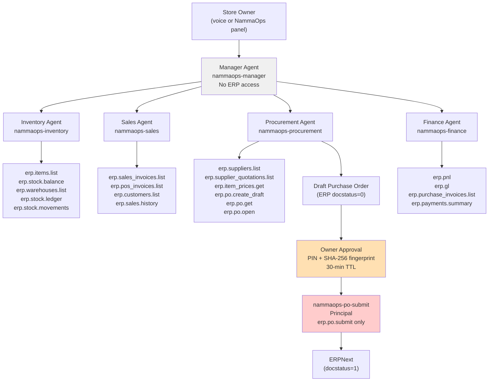

# KiranaCrew Agent Workforce

**KiranaCrew · Great Indian AI Internship Challenge 2026**

This document describes each of the five agents in the KiranaCrew workforce, their ERP capabilities, the workflows they participate in, and their implementation status. All information is sourced directly from `config/nammaops/workforce.json` and `lib/server/nammaops/workforce.mjs`.

---

## Overview

The workforce is defined in two files:

- **`config/nammaops/workforce.json`** — Human-readable agent definitions: roles, responsibilities, allowed and forbidden actions, and the business capability IDs each agent is granted.
- **`config/nammaops/binding.fixture.json`** / **`config/nammaops/binding.hvgerp.json`** — Maps each business capability ID to an actual MCP tool name, risk level, and approval requirements.
- **`lib/server/nammaops/workforce.mjs`** — `setupWorkforce()` registers the MCP server, discovers tools, reviews capabilities, saves agent specializations, and applies grants. Safe to re-run.

### Agent Interaction Diagram



---

## Agent 1: Manager Agent [IMPLEMENTED]

**agent_id:** `nammaops-manager`
**role:** `manager`

### Purpose

Coordinate store operations and give the owner one clear answer. The Manager Agent is the sole entry point for all workflows. It understands the owner's request, picks the matching workflow, delegates to specialists, checks results for consistency, and presents the final business response.

### ERP Capabilities Granted

None. The Manager Agent has no direct ERP access by design. It cannot query stock, read invoices, or create purchase orders. All data access goes through specialist agents under their own identities.

### Workflows It Participates In

All five workflows: `stock_check`, `prepare_reorder`, `daily_report`, `demand_forecast`, `supplier_comparison`. The Manager Agent runs the `consolidate()` step at the end of every workflow, producing the owner-facing summary. When `NAMMAOPS_REASONING=manager`, it also runs one optional OpenClaw reasoning turn — but only after the deterministic numbers are computed, and only if the model figures match exactly.

### What It Cannot Do

- Access ERPNext directly
- Submit purchase orders without owner approval
- Grant or change tool permissions

---

## Agent 2: Inventory Agent [IMPLEMENTED]

**agent_id:** `nammaops-inventory`
**role:** `inventory`

### Purpose

Know the current stock and what is running low. The Inventory Agent reads the full product catalogue and all stock balances from ERPNext. It identifies which products are at or below their reorder level and calculates recommended purchase quantities.

### ERP Capabilities Granted

| Business Capability   | MCP Tool (fixture)  | Risk |
| --------------------- | ------------------- | ---- |
| `erp.items.list`      | `list_items`        | READ |
| `erp.stock.balance`   | `get_stock_balance` | READ |
| `erp.warehouses.list` | `list_warehouses`   | READ |
| `erp.stock.ledger`    | `get_stock_ledger`  | READ |
| `erp.stock.movements` | `list_stock_ledger` | READ |

### Workflows It Participates In

| Workflow              | Step                                                                    |
| --------------------- | ----------------------------------------------------------------------- |
| `stock_check`         | Reads items + stock balance; `analyseStock()` computes low-stock status |
| `prepare_reorder`     | Reads items + stock balance to identify what needs ordering             |
| `demand_forecast`     | Reads items, stock balances, and 90-day stock ledger for forecast input |
| `supplier_comparison` | Resolves spoken product names to ERP item codes                         |

### What It Cannot Do

- Change stock quantities
- Submit stock adjustments
- Delete products
- Submit purchase orders

---

## Agent 3: Sales Agent [IMPLEMENTED]

**agent_id:** `nammaops-sales`
**role:** `sales`

### Purpose

Understand sales performance. The Sales Agent reads submitted sales invoices and POS invoices for a given date range. It computes total sales, transaction counts, and a top-product ranking.

### ERP Capabilities Granted

| Business Capability       | MCP Tool (fixture)    | Risk |
| ------------------------- | --------------------- | ---- |
| `erp.sales_invoices.list` | `list_sales_invoices` | READ |
| `erp.pos_invoices.list`   | `list_pos_invoices`   | READ |
| `erp.customers.list`      | `list_customers`      | READ |
| `erp.items.list`          | `list_items`          | READ |
| `erp.sales.history`       | `list_sales_lines`    | READ |

### Workflows It Participates In

| Workflow          | Step                                                                                                             |
| ----------------- | ---------------------------------------------------------------------------------------------------------------- |
| `daily_report`    | Reads sales invoices and POS invoices for the target date; `aggregateSales()` computes totals and top-5 products |
| `demand_forecast` | Reads 90-day sales history in 7-day slices via `readSlices()`                                                    |

### What It Cannot Do

- Create or modify invoices
- Make payments
- Access purchase data

---

## Agent 4: Procurement Agent [IMPLEMENTED]

**agent_id:** `nammaops-procurement`
**role:** `procurement`

### Purpose

Prepare supplier purchase recommendations and draft orders. The Procurement Agent reads supplier quotations, compares suppliers by price/availability/lead-time using `rankSuppliers()`, and creates draft purchase orders in ERPNext. It cannot submit them.

### ERP Capabilities Granted

| Business Capability            | MCP Tool (fixture)          | Risk  |
| ------------------------------ | --------------------------- | ----- |
| `erp.suppliers.list`           | `list_suppliers`            | READ  |
| `erp.supplier_quotations.list` | `list_supplier_quotations`  | READ  |
| `erp.item_prices.get`          | `get_item_prices`           | READ  |
| `erp.po.create_draft`          | `create_purchase_order`     | WRITE |
| `erp.po.get`                   | `get_purchase_order`        | READ  |
| `erp.po.open`                  | `list_open_purchase_orders` | READ  |

### Workflows It Participates In

| Workflow              | Step                                                                                             |
| --------------------- | ------------------------------------------------------------------------------------------------ |
| `stock_check`         | Optional: compares suppliers for low-stock items via `rankForLow()`                              |
| `prepare_reorder`     | Required: compares suppliers, calculates quantities, creates draft POs via `erp.po.create_draft` |
| `demand_forecast`     | Reads incoming POs and supplier quotations for forecast reorder recommendations                  |
| `supplier_comparison` | Full supplier comparison workflow: reads quotations + prices, ranks by `rankSuppliers()`         |

### Supplier Ranking Rules

From `calculations.mjs`:

1. Eligible: can supply the requested quantity AND quotation is still valid (not past `valid_till`)
2. Among eligible: lowest rate
3. Tie-break: shortest lead time
4. Second tie-break: highest on-time delivery rate

### What It Cannot Do

- Submit purchase orders (requires owner PIN through `nammaops-po-submit` principal)
- Cancel or delete purchase documents
- Create purchase receipts

---

## Agent 5: Finance Agent [IMPLEMENTED]

**agent_id:** `nammaops-finance`
**role:** `finance`

### Purpose

Produce financial summaries from posted accounting data. The Finance Agent reads the Profit and Loss report from ERPNext for a given period. It explicitly refuses to estimate profit from sales invoices or purchase orders — it reports only what accounting has actually posted.

### ERP Capabilities Granted

| Business Capability          | MCP Tool (fixture)       | Risk |
| ---------------------------- | ------------------------ | ---- |
| `erp.pnl`                    | `get_profit_and_loss`    | READ |
| `erp.gl`                     | `get_general_ledger`     | READ |
| `erp.purchase_invoices.list` | `list_purchase_invoices` | READ |
| `erp.payments.summary`       | `get_payment_summary`    | READ |

### Workflows It Participates In

| Workflow       | Step                                                                                                                |
| -------------- | ------------------------------------------------------------------------------------------------------------------- |
| `daily_report` | Optional step: reads posted P&L for the target date; warns if P&L income differs from invoice total by more than 1% |

The Finance Agent step is marked `{ optional: true }` in `workflows.mjs`. If the P&L cannot be read (e.g. no data posted yet), the workflow completes with `status: "partial"` rather than failing.

### What It Cannot Do

- Create journal entries
- Submit payments
- Estimate profit from purchase orders and sales (explicitly forbidden)

---

## Special Principal: nammaops-po-submit [IMPLEMENTED]

This is not a voice-addressable agent. It is a workflow-internal principal that is the only entity permitted to call `erp.po.submit`.

**Why it is separate:** The Procurement Agent can create a draft purchase order (docstatus=0) but cannot submit it. The `nammaops-po-submit` principal exists solely to perform the `erp.po.get` + `erp.po.submit` + `erp.po.get` (confirm) sequence inside `OwnerApprovals.approve()`, and only after:

1. The owner enters the correct PIN (`safeSecretEqual` comparison)
2. The approval request has not expired (30-minute TTL)
3. The current ERP draft fingerprint matches the fingerprint recorded when the draft was first presented (SHA-256 hash of supplier, items, quantities, rates)

The principal is defined in `workforce.json`:

```json
{
  "id": "nammaops-po-submit",
  "purpose": "Submits a purchase order only after the store owner approved that exact order.",
  "business_capabilities": ["erp.po.get", "erp.po.submit"]
}
```

And in `mcp-governance.mjs`:

```javascript
export const WORKFLOW_PRINCIPALS = new Set(["nammaops-po-submit"]);
```

These principals are never reachable through the governed MCP proxy — they only run inside `OwnerApprovals.approve()` on the server.

---

## Voice Department Mapping [IMPLEMENTED]

The `workforce.json` also defines a `voice_departments` section that maps voice seat names to departments. This is **presentation only** — it controls which voice agent the shopkeeper talks to, but it never affects which ERP capabilities are used. Every ERP read runs under the specialist agent's own identity.

| Voice name   | Department  | Title         |
| ------------ | ----------- | ------------- |
| Alice        | manager     | Store Manager |
| Bob          | inventory   | Inventory     |
| Carol        | sales       | Sales         |
| Dave         | procurement | Procurement   |
| (background) | finance     | Finance       |

---

## Implementation Notes

- **Setup is idempotent.** `setupWorkforce()` can be called multiple times safely. Existing specializations, seat bindings, and grants are reused.
- **Blockers are reported, not thrown.** If a tool is not discovered or a seat is unavailable, `setupWorkforce()` returns a `blockers` array instead of crashing. The UI shows these blockers in the NammaOps panel.
- **Fixture vs. live.** The fixture binding (`binding.fixture.json`) connects to `lib/mcp/fixture-erpnext-server.mjs`, which serves synthetic data from `config/nammaops/fixture-data.json`. The live binding (`binding.hvgerp.json`) connects to `lib/mcp/hvgerp-adapter-server.mjs`, which calls the real ERPNext API using `hvgerp-mcp v3.7.0`.
