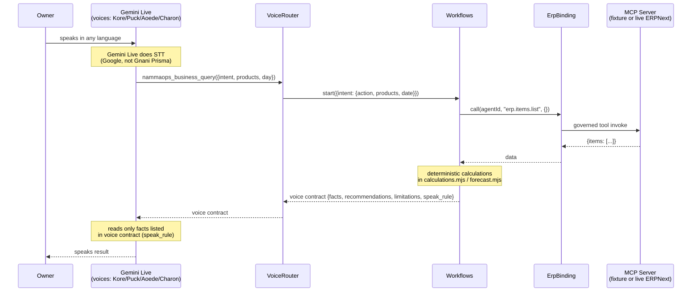
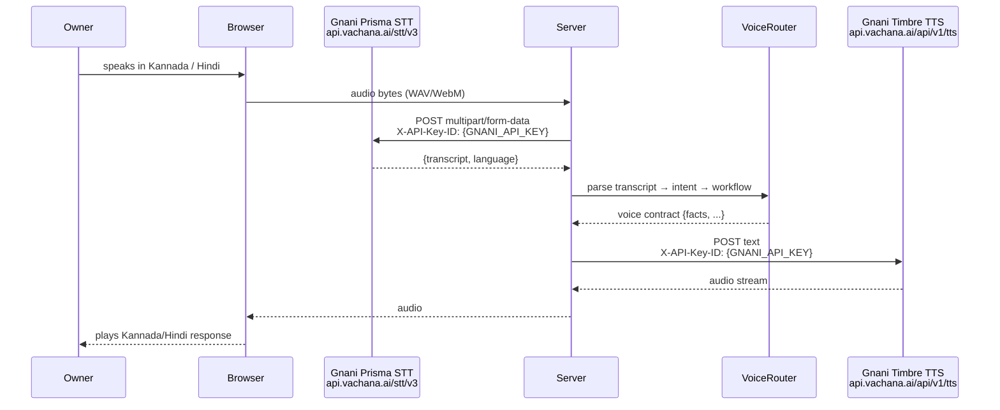
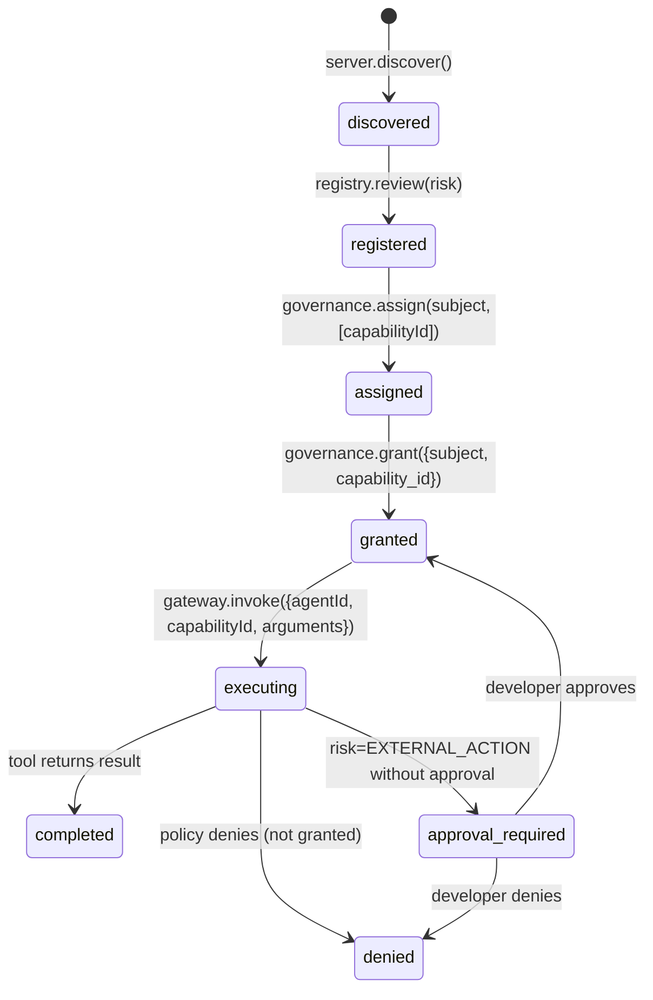

# KiranaCrew — Actual Implemented Architecture

> This document reflects the codebase as it exists on November 2, 2026. It supersedes all prior "proposed" architecture documents. Every claim is sourced from reading the code directly.
> Status labels: [IMPLEMENTED] [STUBBED] [NEEDS GNANI INTEGRATION] [FIXTURE ONLY] [LIVE READY]

---

## 1. What Has Been Built

KiranaCrew is a fully functional kirana-store AI operations platform layered on top of KiranaCrew. The core intelligence is a deterministic multi-agent workflow engine — no LLM is required for business logic, routing, or calculations. An LLM (the existing OpenClaw Manager) is only used for an optional natural-language summary of a completed workflow result.

### Component Status

| Component                                                              | File(s)                                            | Status                              |
| ---------------------------------------------------------------------- | -------------------------------------------------- | ----------------------------------- |
| Five-agent workforce (manager, inventory, sales, procurement, finance) | `config/nammaops/workforce.json` + `workforce.mjs` | [IMPLEMENTED]                       |
| stock_check workflow                                                   | `workflows.mjs`                                    | [IMPLEMENTED]                       |
| prepare_reorder workflow (with owner approval)                         | `workflows.mjs` + `owner-approvals.mjs`            | [IMPLEMENTED]                       |
| daily_report workflow                                                  | `workflows.mjs`                                    | [IMPLEMENTED]                       |
| demand_forecast workflow (with 90-day history)                         | `workflows.mjs` + `forecast.mjs`                   | [IMPLEMENTED]                       |
| supplier_comparison workflow                                           | `workflows.mjs`                                    | [IMPLEMENTED]                       |
| Natural-language command parsing                                       | `parseCommand()` in `workflows.mjs`                | [IMPLEMENTED]                       |
| Deterministic business calculations                                    | `calculations.mjs`                                 | [IMPLEMENTED]                       |
| Statistical demand forecast engine                                     | `forecast.mjs`                                     | [IMPLEMENTED]                       |
| ERPNext binding layer                                                  | `erp-binding.mjs`                                  | [IMPLEMENTED]                       |
| MCP governance (discover, review, assign, grant, invoke, audit)        | `mcp-governance.mjs`                               | [IMPLEMENTED]                       |
| Owner approval (PIN, fingerprint, idempotent submit)                   | `owner-approvals.mjs`                              | [IMPLEMENTED]                       |
| Fixture MCP server (synthetic ERPNext data)                            | `fixture-erpnext-server.mjs`                       | [IMPLEMENTED]                       |
| Live ERPNext adapter (hvgerp, read-only)                               | `hvgerp-adapter-server.mjs`                        | [IMPLEMENTED]                       |
| Voice router (Gemini Live → workflow → voice contract)                 | `voice-router.mjs`                                 | [IMPLEMENTED]                       |
| Group-chat business intent routing                                     | `group-business.mjs`                               | [IMPLEMENTED]                       |
| Gnani Prisma STT provider                                              | `stt.mjs` — `gnaniProvider()`                      | [IMPLEMENTED — needs GNANI_API_KEY] |
| Gemini STT provider (fallback)                                         | `stt.mjs` — `geminiProvider()`                     | [IMPLEMENTED]                       |
| Fixture STT provider (test)                                            | `stt.mjs` — `fixtureProvider()`                    | [IMPLEMENTED]                       |
| REST API (14 endpoints)                                                | `api.mjs` + `openapi.mjs`                          | [IMPLEMENTED]                       |
| KiranaCrewPanel UI                                                     | `components/hud/KiranaCrewPanel.tsx`               | [IMPLEMENTED]                       |
| McpGovernancePanel UI                                                  | `components/hud/McpGovernancePanel.tsx`            | [IMPLEMENTED]                       |
| Governed MCP proxy for OpenClaw                                        | `governed-tools-mcp.mjs`                           | [IMPLEMENTED]                       |
| Gnani Timbre TTS integration                                           | NOT PRESENT in codebase                            | [NEEDS GNANI INTEGRATION]           |
| Voice TTS for KiranaCrew responses                                     | Gemini Live voices (Kore/Puck/Aoede/Charon) used   | [PARTIAL — uses Gemini, not Timbre] |

---

## 2. System Architecture Diagram

```mermaid
graph TB
    subgraph "Browser"
        VA[Voice Agent — Gemini Live session<br/>Alice / Bob / Carol / Dave]
        PANEL[KiranaCrewPanel HUD]
        GOVPANEL[McpGovernancePanel HUD]
    end

    subgraph "KiranaCrew Server (localhost:3108)"
        RTAPI[runtime-api.mjs<br/>routes /api/nammaops/*]

        subgraph "KiranaCrew Engine"
            VR[VoiceRouter<br/>voice-router.mjs]
            WF[Workflows<br/>workflows.mjs]
            OA[OwnerApprovals<br/>owner-approvals.mjs]
            BIND[ErpBinding<br/>erp-binding.mjs]
            CALC[calculations.mjs]
            FORE[forecast.mjs]
        end

        subgraph "Phase C Governance"
            GW[ToolGateway<br/>mcp-governance.mjs]
            GOV[Governance<br/>grants + decisions]
            REG[CapabilityRegistry<br/>discovered tools]
        end

        DB[(SQLite<br/>runtime_records)]
    end

    subgraph "MCP Servers (stdio child processes)"
        FIXTURE[fixture-erpnext-server.mjs<br/>FIXTURE ONLY — synthetic data]
        LIVE[hvgerp-adapter-server.mjs<br/>LIVE — read-only ERPNext]
    end

    subgraph "External"
        HVGERP[@hvgllc/hvgerp-mcp@3.7.0]
        ERPNEXT[ERPNext Cloud<br/>demo store — seeded]
        GNANI_STT[Gnani Prisma STT<br/>api.vachana.ai/stt/v3<br/>NEEDS API KEY]
        GEMINI_LIVE[Gemini Live API<br/>voices + business tool]
    end

    VA -->|nammaops_business_query tool call| RTAPI
    PANEL -->|REST /api/nammaops/*| RTAPI
    GOVPANEL -->|REST /api/developer/*| RTAPI
    RTAPI --> VR
    RTAPI --> WF
    RTAPI --> OA
    VR --> WF
    WF --> BIND
    OA --> BIND
    BIND --> GW
    GW --> GOV
    GW --> REG
    GW --> FIXTURE
    GW --> LIVE
    LIVE --> HVGERP
    HVGERP --> ERPNEXT
    GW --- DB
    WF --- DB
    OA --- DB
    RTAPI -->|STT tasks| GNANI_STT
    VA <-->|audio + text| GEMINI_LIVE
```

---

## 3. Voice Flow

### Current Voice Flow (What Is Built)



### What Needs Gnani Integration



**The Gnani STT REST provider is fully coded (`gnaniProvider()` in `stt.mjs`). It only needs `GNANI_API_KEY` in the environment and `AGENT_TOWN_STT_PROVIDER=gnani`. The gap is wiring this to the KiranaCrew voice path (today voice goes through Gemini Live's built-in STT, not Gnani Prisma). Gnani Timbre TTS has zero implementation in the codebase — it must be written.**

---

## 4. Agent DAG

```mermaid
graph LR
    subgraph "stock_check"
        S1[inventory<br/>list items + stock] --> S2{low items?}
        S2 -->|yes| S3[procurement<br/>rank suppliers]
        S2 -->|no| S4[manager<br/>summarize]
        S3 --> S4
    end

    subgraph "prepare_reorder"
        R1[inventory<br/>list items + stock] --> R2[procurement<br/>rank + create drafts]
        R2 --> R3[OWNER APPROVAL<br/>PIN required]
        R3 --> R4[manager<br/>summarize]
    end

    subgraph "daily_report"
        D1[sales<br/>invoices + POS] --> D2{P&L available?}
        D2 -->|yes| D3[finance<br/>profit + loss]
        D2 -->|no| D4[manager<br/>summarize]
        D3 --> D4
    end

    subgraph "demand_forecast"
        F1[sales<br/>90-day history] --> F3[inventory<br/>stock + ledger]
        F3 --> F4[procurement<br/>open POs + quotations]
        F4 --> F5[manager<br/>summarize]
    end

    subgraph "supplier_comparison"
        C1[inventory<br/>resolve product names] --> C2[procurement<br/>quotations + prices]
        C2 --> C3[manager<br/>summarize]
    end
```



---

## 5. MCP Governance State Machine



Every ERP call in KiranaCrew passes through this state machine under the identity of the specialist agent making the call. The owner approval for purchase orders is a separate business gate on top of this.

---

## 6. ERPNext Integration Status

### Fixture Mode [IMPLEMENTED]

| Capability                   | Tool                      | Status        |
| ---------------------------- | ------------------------- | ------------- |
| erp.items.list               | list_items                | [IMPLEMENTED] |
| erp.stock.balance            | get_stock_balance         | [IMPLEMENTED] |
| erp.warehouses.list          | list_warehouses           | [IMPLEMENTED] |
| erp.stock.ledger             | get_stock_ledger          | [IMPLEMENTED] |
| erp.stock.movements          | list_stock_ledger         | [IMPLEMENTED] |
| erp.suppliers.list           | list_suppliers            | [IMPLEMENTED] |
| erp.supplier_quotations.list | list_supplier_quotations  | [IMPLEMENTED] |
| erp.item_prices.get          | get_item_prices           | [IMPLEMENTED] |
| erp.po.create_draft          | create_purchase_order     | [IMPLEMENTED] |
| erp.po.get                   | get_purchase_order        | [IMPLEMENTED] |
| erp.po.submit                | submit_purchase_order     | [IMPLEMENTED] |
| erp.sales_invoices.list      | list_sales_invoices       | [IMPLEMENTED] |
| erp.pos_invoices.list        | list_pos_invoices         | [IMPLEMENTED] |
| erp.customers.list           | list_customers            | [IMPLEMENTED] |
| erp.pnl                      | get_profit_and_loss       | [IMPLEMENTED] |
| erp.gl                       | get_general_ledger        | [IMPLEMENTED] |
| erp.purchase_invoices.list   | list_purchase_invoices    | [IMPLEMENTED] |
| erp.payments.summary         | get_payment_summary       | [IMPLEMENTED] |
| erp.sales.history            | list_sales_lines          | [IMPLEMENTED] |
| erp.po.open                  | list_open_purchase_orders | [IMPLEMENTED] |

### Live ERPNext Mode [LIVE READY — read-only]

All read capabilities above work against live ERPNext. The following are disabled on live:

| Capability           | Disabled reason                                   |
| -------------------- | ------------------------------------------------- |
| erp.po.create_draft  | Live PO drafts not enabled (G2 is read-only)      |
| erp.po.get           | Only needed with live PO drafts                   |
| erp.po.submit        | Needs PIN path and constrained tool — not enabled |
| erp.payments.summary | No reviewed live tool yet                         |

Verified live: 36 items, 35 bins, 479 invoices, P&L reconciles, 64 governed reads, 0 writes.

---

## 7. What Needs Gnani Integration (Exact Files and Functions)

### Gap 1: Wire Gnani Prisma STT to KiranaCrew Voice Path

**What exists**: `lib/server/stt.mjs` — `gnaniProvider()` is fully implemented. It POSTs to `https://api.vachana.ai/stt/v3` with `X-API-Key-ID` auth, handles multipart/form-data audio upload, 60s timeout, error mapping.

**What is missing**: The KiranaCrew voice path today uses Gemini Live's built-in speech recognition (audio goes directly to Gemini, not to Gnani). To use Gnani Prisma, a separate audio capture + STT path must be added that:

1. Captures audio from the browser (existing AudioWorklet infrastructure in `lib/voice/`)
2. Sends audio bytes to server at `POST /api/voice/transcribe` or similar
3. Server calls `gnaniProvider().transcribe({bytes, mime, language})`
4. Transcript is returned to browser for display and then to intent router

Required env vars: `AGENT_TOWN_STT_PROVIDER=gnani`, `GNANI_API_KEY=<key>`

**Files to change**: Add a server route (possibly in `runtime-api.mjs` or a new `stt-api.mjs`); add a browser component for transcript display; optionally add a standalone KiranaCrew voice page separate from the existing Gemini Live voice page.

### Gap 2: Implement Gnani Timbre TTS

**What exists**: Zero. The Gemini Live voices (Kore, Puck, Aoede, Charon) provide TTS today, handled entirely within the Gemini Live SDK.

**What is needed**: A `timbreProvider()` function in `stt.mjs` or a new `lib/server/tts.mjs`, plus a server route that accepts text and returns audio bytes from `POST https://api.gnani.ai/v1/tts/inference` (or WebSocket variant) with `X-API-Key-ID` auth.

**Files to create/change**: `lib/server/tts.mjs` (new); server route for TTS proxy; browser audio player that plays the Timbre audio response.

### Gap 3 (optional): Standalone Gnani Voice Page

The current voice path is deeply coupled to Gemini Live. For the hackathon demo, a standalone page at `/nammaops/voice` that uses Gnani Prisma STT + KiranaCrew intent routing + Gnani Timbre TTS would be the most direct Gnani integration demonstration and would not require changing the existing Gemini Live voice path at all.

This is the recommended approach for Day 2-3 of the hackathon schedule.

---

## 8. What Is Fixture Only vs Live Ready

| Feature                    | Fixture       | Live ERPNext                      |
| -------------------------- | ------------- | --------------------------------- |
| Stock check                | [IMPLEMENTED] | [LIVE READY]                      |
| Daily report (sales)       | [IMPLEMENTED] | [LIVE READY]                      |
| Daily report (P&L profit)  | [IMPLEMENTED] | [LIVE READY]                      |
| Demand forecast (90-day)   | [IMPLEMENTED] | [LIVE READY]                      |
| Supplier comparison        | [IMPLEMENTED] | [LIVE READY]                      |
| Prepare reorder (draft PO) | [IMPLEMENTED] | [FIXTURE ONLY — disabled on live] |
| Owner approval + submit    | [IMPLEMENTED] | [FIXTURE ONLY — disabled on live] |
| Payments summary           | [IMPLEMENTED] | [FIXTURE ONLY — no live tool yet] |
