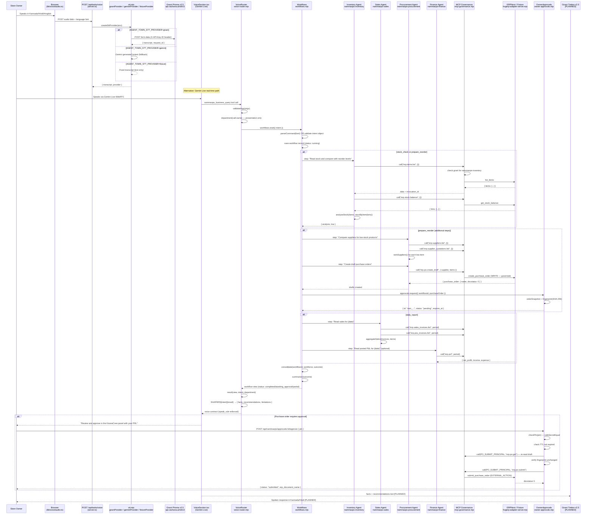

# Voice Command Lifecycle

**KiranaCrew · Great Indian AI Internship Challenge 2026**

This document traces the complete path of a voice command from the shopkeeper's mouth to the spoken response. Every step cites the actual source file that implements it.

---

## Complete Sequence Diagram

---

## Step-by-Step Lifecycle

### Step 1: Audio Capture [IMPLEMENTED]

**File:** `lib/voice/audio.ts`

The browser captures microphone audio using the Web Audio API. Audio is encoded as `audio/webm` (or the browser's default) and sent as a multipart form upload to `POST /api/tasks/voice`.

For the Gemini Live real-time path, audio is streamed via WebRTC through `lib/voice/client.ts` and `VoiceSection.tsx`, which connects to Google Gemini Live and injects the `nammaops_business_query` tool into the session.

### Step 2: Gnani Prisma STT Transcription [IMPLEMENTED — KEY REQUIRED]

**File:** `lib/server/stt.mjs` → `gnaniProvider()`

The server's `createSttProvider()` reads `AGENT_TOWN_STT_PROVIDER`:

- `gnani` → posts audio to `https://api.vachana.ai/stt/v3` with `X-API-Key-ID: {GNANI_API_KEY}`
- `gemini` → uses Gemini's `generateContent` API as a fallback
- `fixture` → returns a fixed transcript (for testing without a real API key)
- unset → returns HTTP 503

The Gnani response includes `{ transcript, request_id }`. The `request_id` is preserved in the response for audit purposes.

### Step 3: Voice Router Intent Matching [IMPLEMENTED]

**File:** `lib/server/nammaops/voice-router.mjs`

The `VoiceRouter.query()` method receives the transcribed text (or a direct structured intent from the Gemini Live tool call) and identifies the business intent. The eight supported intents are:

| Voice Intent             | Maps to Workflow      | Example phrase                        |
| ------------------------ | --------------------- | ------------------------------------- |
| `list_products`          | `stock_check`         | "Show me all products"                |
| `check_stock`            | `stock_check`         | "Check the stock of milk"             |
| `sales_summary`          | `daily_report`        | "How much did I sell today?"          |
| `top_selling_products`   | `daily_report`        | "What sold the most today?"           |
| `business_profit`        | `daily_report`        | "How much profit did I make?"         |
| `demand_forecast`        | `demand_forecast`     | "What will I need next week?"         |
| `supplier_comparison`    | `supplier_comparison` | "Which supplier is cheapest for oil?" |
| `prepare_purchase_order` | `prepare_reorder`     | "Order what's running low"            |

The voice router applies idempotency: one spoken tool call (`actionId`) starts at most one workflow, even across HTTP retries or reconnects. Duplicate calls return the existing workflow's result.

**Important security note from the code:** _"The voice seat's department is presentation: it is never used to authorize a call. Voice cannot approve or submit a purchase."_

### Step 4: Manager Agent Delegation [IMPLEMENTED]

**File:** `lib/server/nammaops/workflows.mjs` → `Workflows.execute()`

The Manager Agent receives the normalized intent object and calls the appropriate workflow method:

- `stock_check` → `Workflows.stockCheck()`
- `prepare_reorder` → `Workflows.prepareReorder()`
- `daily_report` → `Workflows.dailyReport()`
- `demand_forecast` → `Workflows.demandForecast()`
- `supplier_comparison` → `Workflows.supplierComparison()`

### Step 5: Workflow Execution [IMPLEMENTED]

**Files:** `lib/server/nammaops/workflows.mjs`, `lib/server/nammaops/calculations.mjs`, `lib/server/nammaops/forecast.mjs`

Each workflow is a sequence of `step()` calls, each of which:

1. Creates a child task record in SQLite with the specialist agent's identity
2. Calls ERP tools through the governance layer (`this.binding.call(agentId, businessId, args)`)
3. Records every ERP invocation in the task's `evidence` array
4. Returns deterministic results computed by pure functions (no model calls for numbers)

### Step 6: Owner Approval (where required) [IMPLEMENTED]

**File:** `lib/server/nammaops/owner-approvals.mjs`

Purchase order workflows end with status `awaiting_approval`. The `OwnerApprovals` class enforces:

1. **PIN verification:** `safeSecretEqual(pin, this.pin)` — constant-time comparison
2. **TTL check:** 30-minute expiry on each approval request
3. **Fingerprint check:** SHA-256 hash of `{ name, supplier, docstatus, grand_total, items }` must match between request creation and approval time. If the ERP draft changed, the approval is invalidated and a new reorder must be prepared.
4. **Idempotency:** The approval request is claimed (status → `submitting`) before the ERP call. A concurrent approval attempt fails on the database revision check.

Voice agents **cannot** approve purchase orders. The `speak_rule` field in every voice contract includes: _"Voice cannot approve or submit a purchase order."_

### Step 7: Result Generation [IMPLEMENTED]

**File:** `lib/server/nammaops/voice-router.mjs` → `SHAPERS`

Each intent has a dedicated shaper function that transforms the raw workflow result into voice-friendly arrays:

- `facts` — statements the agent should say
- `recommendations` — actions it should suggest
- `limitations` — caveats it must mention (data source, missing information)

The `speak_rule` field is always: _"Say only these facts, recommendations and limitations. Do not add numbers, products or outcomes that are not listed here."_ This prevents the language model from hallucinating numbers that were not computed from ERP data.

### Step 8: Gnani Timbre TTS Response [PLANNED]

**Status:** No `tts.mjs` file exists. The voice contract is ready to be spoken — the `facts` and `recommendations` arrays are already formatted as natural sentences — but the synthesis step is not yet wired.

See `docs/GNANI_INTEGRATION.md` for the planned implementation.

---

## Voice Intent Reference

### `check_stock` — Stock Check

**Input:** Product names (optional; empty = all products)

**ERP calls:** `erp.items.list` (Inventory), `erp.stock.balance` (Inventory), `erp.suppliers.list` + `erp.supplier_quotations.list` (Procurement, if items are low)

**Output facts:** For each product: current stock, reorder level, status (ok/low/no_reorder_level)

**Output recommendations:** For each low-stock item: "Buy {qty} {product} from {supplier} at {rate}."

### `prepare_purchase_order` — Prepare Reorder

**Input:** Product names (optional; empty = all low-stock items)

**ERP calls:** All of stock_check, plus `erp.po.create_draft`, `erp.po.get`

**Output facts:** Draft PO names, suppliers, totals, item lists

**Approval:** Sets `approval_required: true`. Voice response includes approval IDs and location ("KiranaCrew panel — owner PIN required").

### `daily_report` / `sales_summary` / `top_selling_products` / `business_profit`

**Input:** Day (`today`, `yesterday`, or `YYYY-MM-DD`)

**ERP calls:** `erp.sales_invoices.list`, `erp.pos_invoices.list`, `erp.items.list` (Sales), `erp.pnl` (Finance, optional)

**`business_profit` note:** If P&L data is not available (Finance step failed), returns status `unavailable` with explanation. Profit is **never** estimated from invoices alone.

### `demand_forecast`

**Input:** Product names (optional; empty = all items)

**ERP calls:** 90-day `erp.sales.history` in 7-day slices (Sales), `erp.items.list` + `erp.stock.balance` + `erp.stock.movements` (Inventory), `erp.po.open` + `erp.suppliers.list` + `erp.supplier_quotations.list` (Procurement, optional)

**Forecast methods** (selected by lowest WAPE on held-out data):

- `ma7` — 7-day moving average
- `ma30` — 30-day moving average
- `weighted` — Exponential smoothing (alpha=0.3)
- `weekday` — 30-day average with weekday pattern (requires ≥28 observed days)

**Limitations always stated:** "Historical-demand forecast from this store's own sales; it does not see events, weather, prices or competitors."

### `supplier_comparison`

**Input:** Product names (required), optional quantity

**ERP calls:** `erp.items.list` (Inventory), `erp.suppliers.list` + `erp.supplier_quotations.list` + `erp.item_prices.get` (Procurement)

**Ranking rules:** Suitable = can supply quantity AND quotation not expired. Among suitable: lowest rate → shortest lead time → best on-time rate.
